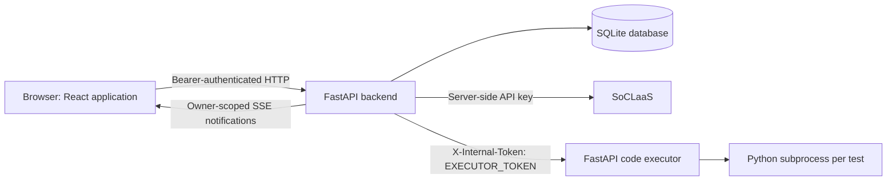
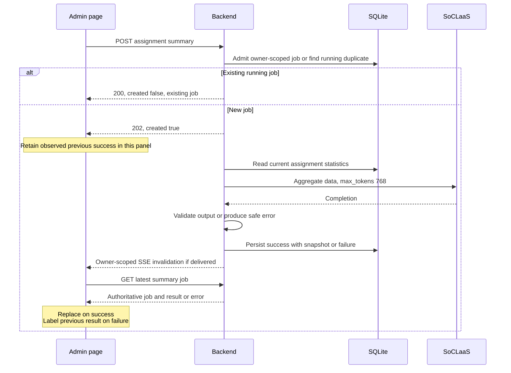
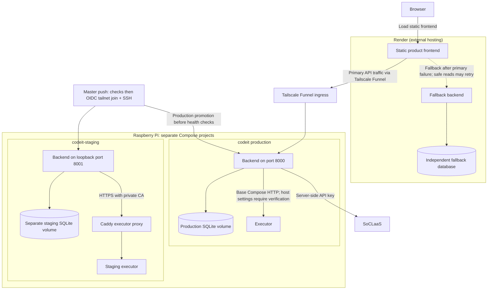

# CodeIt Developer Guide

This guide describes the implementation of CodeIt. It accompanies the [User Guide](UserGuide.md) and [Reflections](Reflections.md), and addresses the additional engineering requirements in the [assignment brief](../assignment-brief.md).

## Contents

1. [Product and scope](#1-product-and-scope)
2. [Architecture](#2-architecture)
3. [Design decisions and principles](#3-design-decisions-and-principles)
4. [Local setup](#4-local-setup)
5. [AI context, guardrails and resource use](#5-ai-context-guardrails-and-resource-use)
6. [Security, verification and testing](#6-security-verification-and-testing)
7. [Software engineering process](#7-software-engineering-process)
8. [Deployment and development/production separation](#8-deployment-and-developmentproduction-separation)
9. [Acknowledgements](#9-acknowledgements)

### Where to verify each requirement

| Requirement | Where to verify it |
| --- | --- |
| Shared-component design using SRP/DRY | [Section 2](#2-architecture) and [Section 3](#3-design-decisions-and-principles) |
| AI feature for each role, using SoCLaaS | [Section 1](#1-product-and-scope) and [Section 5](#5-ai-context-guardrails-and-resource-use); [User Guide](UserGuide.md) |
| AI security controls and tests | [Section 5](#5-ai-context-guardrails-and-resource-use) and [Section 6](#6-security-verification-and-testing) |
| Context engineering and resource-aware use | [Section 5](#5-ai-context-guardrails-and-resource-use) and [Section 7](#7-software-engineering-process) |
| Specialized-agent coordination and SDD evidence | [Section 7](#7-software-engineering-process) and the linked `workflow/` and `logs/` artifacts |
| Description of the `workflow/` directory files | [Section 7](#7-software-engineering-process) — [Workflow directory](#workflow-directory-workflow) |
| Tests and error handling | [Section 6](#6-security-verification-and-testing) |
| Separate online deployment and development setup | [Section 4](#4-local-setup) and [Section 8](#8-deployment-and-developmentproduction-separation) |
| Data persistence, backup and recovery | [Section 8](#8-deployment-and-developmentproduction-separation) |
| Reused material and attributions | [Section 9](#9-acknowledgements) |

## 1. Product and scope

CodeIt is a Python programming assignment platform with three roles.

| Role | Core features | SoCLaaS AI feature |
| --- | --- | --- |
| Admin | Manage accounts, classes and memberships; inspect assignment statistics | Generate a narrative summary of assignment progress |
| Teacher | Maintain a personal question bank; create and manage class assignments | Generate, revise and approve question drafts |
| Student | Solve assigned questions; run visible tests; submit against all tests; revisit submissions | Request a hint, optionally with a specific question; analyze saved submission complexity |

The runtime hint feature uses bounded LLM tool calls. The specialized development agents are a separate software engineering workflow; the application does not run those development agents.

## 2. Architecture



The frontend uses React, TypeScript, React Router, TanStack Query, Tailwind CSS and CodeMirror. Vite builds static files; the frontend Docker image serves them through Nginx with SPA route fallback. Both Python services use FastAPI, Pydantic and HTTPX, with Python 3.14 or later required by their package manifests.

The backend owns accounts, authorization, persistence, AI orchestration and submission records. The executor accepts code and test cases from the backend and returns deterministic judging results. Only the backend holds the SoCLaaS API key; browser configuration contains the public API origin.

### Module responsibilities and shared components

| Location | Responsibility |
| --- | --- |
| `backend/app/main.py`, `config.py` | App factory, startup/shutdown, environment configuration, bootstrap admin and service clients |
| `backend/app/auth.py`, `routers/auth.py` | Password verification, opaque bearer sessions and role dependencies |
| `backend/app/routers/` | HTTP validation, role and object access checks, dispatch to repositories/jobs |
| `backend/app/repos/` | Shared, parameterized SQL and database row conversion |
| `backend/app/schemas.py` | Shared request, response and AI draft validation models |
| `backend/app/jobs/` | Common job lifecycle, deduplication, timeout handling and SSE notifications |
| `backend/app/ai/` | Hint generator/reviewer, question generation, complexity analysis, summaries and shared guardrails |
| `backend/app/clients/` | SoCLaaS and executor HTTP contracts and safe failure handling |
| `backend/app/judging.py` | Visible/all-test selection, hidden-result redaction and submission persistence |
| `code-execution/app/` | API/auth, job queue, subprocess runner, resource limits, output comparison and traceback sanitization |
| `frontend/src/api/`, `auth/` | Shared API client, query keys, session storage and authentication lifecycle |
| `frontend/src/jobs/`, `events/` | Shared asynchronous job state and SSE-driven query refresh |
| `frontend/src/components/` | Reusable layout, role guard, forms, Markdown, errors and status displays |
| `frontend/src/features/` | Role-specific screens and API hooks |

### Data model

The authoritative schema is [backend-schema.sql](../backend/backend-schema.sql). Accounts have many sessions and belong to classes through `class_members`. Teachers own questions with ordered test cases. Assignments belong to classes and refer to one to three questions through `assignment_questions`. Submissions belong to a student and an assignment/question pair; jobs retain asynchronous inputs, results and status.

SQLite uses WAL mode, foreign keys and a busy timeout. Constraints enforce unique usernames/class names, question ordering and job deduplication. A partial unique index permits at most one `in_process` job for each `(user_id, kind, target_key)`. A unique `source_job_id` prevents approving one generated draft twice.

Assignments reference editable question records rather than immutable snapshots. Editing a question changes it wherever it is assigned; existing submissions are not automatically rejudged. A question in use cannot be deleted, and a question with submissions cannot be removed from an assignment. Deleting an assignment cascades to its submissions; deleting a class also removes its assignments and memberships. Deleting a teacher leaves question/assignment creator references null.

### Role workflows and persistence

Teachers generate a draft, optionally revise a selected successful draft with feedback, approve it into their personal question bank, then select bank questions for an assignment. Revision includes the selected parent draft rather than the entire history. Approval creates an editable question with `source_job_id`; it does not create an assignment or publish one. The reference solution remains in the job draft and is excluded from the bank question. Validation checks structure, required visible/hidden tests and code bounds, not solution correctness: the backend neither compiles nor executes the reference solution. See [teacher routes](../backend/app/routers/teacher.py), [generation](../backend/app/ai/question_gen.py) and [validation models](../backend/app/schemas.py).

Assignment creation requires current class membership and 1-3 distinct questions owned by that teacher. Co-teachers can read class assignments and their full questions/tests, but only the assignment creator can edit or delete them. Students access assignments through current class membership; there is no frozen publication roster.

Run uses visible tests and creates no submission record. Submit sends visible tests first, then hidden tests, and saves the code and judged verdict, including non-Accepted verdicts. The executor stops at the first failure. A successful job means judging completed, not necessarily that the program was Accepted. Submit admission after the deadline returns 409; Run and Hint remain available. Submission history is newest first, excludes code in list responses, and exposes code only through an owner-scoped detail request. A question is solved when the student has any Accepted submission for that assignment/question pair. Hidden-test status, timing and counts remain visible; hidden stdout/stderr and hidden failure messages are removed. See [judging](../backend/app/judging.py) and [student routes](../backend/app/routers/student.py).

Admins create teacher/student accounts; account roles cannot be changed through account updates, and admins cannot join classes or delete themselves. Password changes invalidate the affected user's sessions. Assignment statistics count current student members only: attempted means at least one saved Submit, correct means any Accepted submission, solved all means Accepted on every assigned question, and verdict totals count submissions rather than distinct students. Run alone does not count as participation. See [admin routes](../backend/app/routers/admin.py) and [statistics queries](../backend/app/repos/submissions.py).

Editor drafts are browser-local, keyed by user/assignment/question, and separate from saved submissions; storage can fail. [Database initialization](../backend/app/db.py) creates the schema and includes a specific upgrade for the complexity job kind, not a general migration framework.

### Asynchronous jobs and frontend state

Run, submit, hint, complexity analysis, question generation and assignment summary all follow:

```text
POST action -> in_process -> success(result) or failed(safe error)
                      -> owner-scoped SSE notification -> GET updated job
```

A newly created job returns HTTP 202 with `created: true`. A duplicate in-progress action returns HTTP 200 with `created: false` and the existing job; the new input is ignored. Checking a job never starts work. Target keys are `a<assignment>:q<question>` for run/submit/hint, `a<assignment>` for summaries, `a<assignment>:q<question>:s<submission>` for complexity, and `-` for question generation.

SSE carries identifiers rather than source code or results. The frontend refetches the affected queries and reconciles job responses so an older response cannot replace a newer job or revert a completed job to `in_process`. It uses one event stream per tab rather than periodic job polling. Reconnection refreshes relevant state. Notifications are best-effort: the in-process hub has bounded queues and drops notifications when full, with no durable replay. Session validity is rechecked after idle heartbeat timeouts, not before every event. Resource admission checks do not imply cancellation or reauthorization of already accepted work at completion; generic historical job reads remain owner-scoped.

Jobs and the SSE hub execute in memory in one backend process, while job records persist in SQLite. Startup marks interrupted jobs failed; it does not resume them. Keep the backend at **one Uvicorn worker**. Multiple backend workers/replicas require a shared queue and event system before they are safe. The executor also uses one worker because its semaphore is process-local.

## 3. Design decisions and principles

This separation applies SRP: routers authorize requests, repositories perform database access, and clients handle upstream services. DRY is especially important for the three role implementations: they share schemas, guards, repositories and one job runner instead of duplicating those mechanisms.

The following material decisions are described in context throughout this guide; they are collected here with their trade-offs so the design rationale is visible in one place.

| Decision | Why it fits CodeIt | Trade-off and where it is enforced |
| --- | --- | --- |
| Keep the browser, backend, SoCLaaS and executor responsibilities separate, with only the backend holding the SoCLaaS key. | The backend owns authorization, persistence and all provider calls, keeping credentials and authoritative state out of the browser. | The frontend depends on documented API contracts; change a contract with its spec, implementation and tests. See [Section 2](#2-architecture). |
| Use SQLite with one backend process and one Uvicorn worker. | Short transactions atomically check ownership, deduplicate jobs and persist results on one local database. | SQLite-local admission and the in-memory SSE hub do not support horizontal scaling; a shared queue/event system is required before adding workers. See [Section 2](#asynchronous-jobs-and-frontend-state). |
| Run asynchronous jobs in memory with persisted job rows, rather than a durable queue. | Browser disconnects do not cancel accepted work, and the model stays simple. | A restart marks interrupted jobs failed rather than resuming them; notifications are best-effort with bounded queues. See [Section 2](#asynchronous-jobs-and-frontend-state). |
| Have the private hint reviewer fail open on error, timeout or invalid output. | A reviewer outage still returns the already-guarded hint rather than blocking the student feature. | This is a mitigation, not guaranteed answer-leak prevention; residual risk is acknowledged. See [Section 5](#5-ai-context-guardrails-and-resource-use) and [Section 6](#6-security-verification-and-testing). |
| Assignments reference editable question records rather than immutable snapshots. | Editing a question updates it everywhere it is assigned without copying data. | Existing submissions are not automatically rejudged; deletion/removal guards protect in-use questions. See [Section 2](#data-model). |
| Offer an optional independent fallback backend origin rather than replicated storage. | A tab can keep working for safe reads when the primary origin fails. | Databases and sessions are independent; writes are never replayed automatically. See [Section 4](#backend-selection) and [Section 8](#8-deployment-and-developmentproduction-separation). |

## 4. Local setup

### Docker Compose

Install Docker with Compose. From the repository root, create the service environment files if they do not already exist:

```bash
cp -n backend/.env.example backend/.env
cp -n code-execution/.env.example code-execution/.env
```

Edit these files locally; do not commit secrets. Set a valid `SOCLAAS_API_KEY`, select available `LLM_MODEL` and tool-capable `HINT_GENERATOR_MODEL` values, and replace `EXECUTOR_TOKEN` with the same private value in both files. The backend checks the global and hint generator model availability through `/v1/models` during startup, so even local Docker startup needs a reachable SoCLaaS service and a valid key. The example selects `x-test-4`; the Python settings fallback is `coder`. The hint reviewer uses `HINT_REVIEWER_MODEL`; an unavailable reviewer does not block startup and review failures return the guarded hint. Availability alone does not establish tool-call support or reviewer quality: verify both separately with synthetic data.

Keep `APP_ENV=dev` for this local stack. Choose the bootstrap admin password explicitly. The example has `BOOTSTRAP_ADMIN_USERNAME=admin` and `BOOTSTRAP_ADMIN_PASSWORD=change-me`; bootstrap runs before demo seeding, so that admin uses the configured password rather than `demo1234`.

```bash
docker compose up -d --build
docker compose ps
docker compose logs --tail=100 backend
curl http://localhost:8000/api/health
```

Open `http://localhost:5173`. The API is at `http://localhost:8000`; development API documentation is at `/docs`. The executor has no published host port. Compose overrides its backend URL to `http://code-executor:8001` and mounts the SQLite volume at `/data`.

Compose starts containers in dependency order but does not define readiness health checks. Inspect startup logs if the API is not ready immediately. `docker compose down` stops the stack while preserving its named database volume; `docker compose down -v` deletes that database and should only be used when intentionally resetting disposable data.

### Running services directly

Use Linux for the executor: it relies on Unix resource limits, process groups, `/proc` and `pidfd`. Use Python 3.14+, `uv`, and Node.js/npm; the frontend Docker build uses Node 24. Create the backend and executor `.env` files as above, then copy `frontend/.env.example` to `frontend/.env` if needed.

In separate terminals:

```bash
# Terminal 1
cd code-execution
uv sync
WORK_ROOT=/tmp/codeit-executor uv run uvicorn app.main:app --port 8001 --workers 1
```

```bash
# Terminal 2: set CODE_EXECUTION_SERVER=http://localhost:8001 in backend/.env
cd backend
uv sync
DATABASE_PATH=./dev.db uv run uvicorn app.main:app --port 8000 --workers 1
```

```bash
# Terminal 3
cd frontend
npm ci
npm run dev
```

Direct execution is useful for debugging; it does not provide the container/network restrictions in Compose. Use the containerized executor when testing untrusted submissions. Exported shell environment variables override `.env`; this precedence previously caused a live integration failure described in the reflection.

### Backend selection

With a fallback configured, the browser probes the primary `/api/health/ready`, which checks executor health, with an eight-second timeout and one retry. If both attempts fail, it selects the fallback for the tab. A later primary network/5xx failure switches subsequent traffic to fallback; GET/HEAD may retry once there, but writes are never replayed automatically because the primary may already have processed them. The deployments have independent databases, accounts and sessions: this is not replicated storage or transparent session failover. See [frontend setup](../frontend/README.md), [origin selection](../frontend/src/api/origin.ts) and [API client](../frontend/src/api/client.ts).

### Configuration reference

| Variable | Meaning |
| --- | --- |
| `APP_ENV` | `dev` seeds demo accounts and exposes API docs; `prod` disables both and requires an HTTPS executor URL. Defaults to `dev`. |
| `DATABASE_PATH` | SQLite path; default `/data/app.db`. Use a writable local path for direct development. |
| `SESSION_TTL_HOURS` | Session lifetime; default 12 hours. |
| `BOOTSTRAP_ADMIN_USERNAME`, `BOOTSTRAP_ADMIN_PASSWORD` | Create an initial admin if none exists; changing these does not reset an existing admin. |
| `SOCLAAS_BASE_URL`, `SOCLAAS_API_KEY` | Server-side gateway configuration; the client tolerates a trailing `/v1`. |
| `LLM_MODEL` | Model for teacher generation and admin summaries; settings default `coder`. |
| `COMPLEXITY_MODEL` | Submission complexity model; default `qwen3.6:35b`; not checked at startup. |
| `HINT_GENERATOR_MODEL` | Tool-capable hint generator; default `qwen3-coder-next`, checked at startup. |
| `HINT_REVIEWER_MODEL` | Private hint reviewer; default `nemotron3.5:30b`, unavailability fails open. |
| `LLM_JOB_TIMEOUT_S` | Overall AI job deadline and chat HTTP timeout; default 300 seconds. |
| `CODE_EXECUTION_SERVER`, `EXECUTOR_TOKEN` | Executor endpoint and shared secret sent as `X-Internal-Token`. |
| `EXECUTOR_CA_FILE` | Optional private CA certificate added to standard TLS roots for executor HTTPS. |
| `MAX_CONCURRENT_JOBS`, `QUEUE_TIMEOUT_S` | Executor concurrency and slot wait; defaults 100 and 30 seconds. |
| `WORK_ROOT` | Executor temporary directory, `/work` in Compose. |
| `VITE_API_BASE_URL`, `VITE_API_FALLBACK_URL` | Primary and optional fallback public backend origins without `/api`, embedded at build time. Production builds require HTTPS. |

Additional executor limits are defined in [config.py](../code-execution/app/config.py). The concurrency default is a configuration value, not a demonstrated capacity guarantee; size it against available memory/CPU and load-test the chosen deployment.

## 5. AI context, guardrails and resource use

| Feature | Context and boundaries | Work budget before HTTP retries |
| --- | --- | --- |
| Student hint | Generator starts with title and optional student question and may retrieve code and question/visible tests via two allowlisted tools; hidden tests remain excluded. A separate private reviewer receives question context, hidden expected outputs and the guarded candidate; hidden inputs are excluded. | Generator: initial completion plus at most three tool rounds, final `tool_choice=none`, 1,024 tokens per completion. Reviewer: one tool-free call, at most 128 tokens, 64 KiB input and 20 seconds, with a one-second job deadline margin. Oversize, timeout and invalid reviews fail open with content-free logging |
| Teacher generation | Difficulty, topics, teacher prompt; revision includes the selected parent draft and feedback. JSON is validated as `QuestionDraft`. | Up to two completions, with one repair attempt for invalid output; 16,384 output tokens per completion |
| Student complexity | Saved submission code only; owner and current assignment membership required, regardless of verdict. Advisory Big O time/auxiliary-space estimates with assumptions; no tools or execution. | Up to three attempts, 1,500 output tokens each. Each attempt gets 95% of the job timeout divided by three; fresh nonce/canary per attempt. Canary leakage fails immediately. |
| Admin summary | Database-derived aggregate statistics for current class students; no student names or source code | One logical completion; maximum 768 output tokens, subject to the shared HTTP retry policy |

The SoCLaaS client retries HTTP 429/503 twice after 2 and 5 seconds. Other HTTP/network failures become a generic user-facing service error. The overall job timeout bounds the operation, including retries. These measures reduce failure amplification but **do not implement a global requests-per-minute limiter** across users. The repository does not establish the service's current quota or prove quota compliance under load; deployment must verify the account's limits and add shared throttling if required.

Hint, question-generation and summary prompt templates live in `backend/app/ai/prompts/`; complexity builds its prompt in `backend/app/ai/complexity.py`. Shared guards scan new hint inputs, saved code submitted for complexity analysis, and generation prompts/feedback/topics before a job is created. Untrusted text is wrapped with per-job nonce tags; nested imitation tags are stripped repeatedly. The system prompt treats tagged text and tool results as data. A random canary detects one class of prompt leakage. Hint output is capped at 4,000 characters and long fenced code blocks are replaced; summary output is capped at 2,000 characters. These are layered mitigations, not proof that every injection or complete-solution leak is prevented.

Complexity output must be a JSON object with exactly four nonempty string fields: time/space complexity (at most 100 characters each), explanation (3,000) and assumptions (1,500). Responses over 5,000 characters or containing tool calls are rejected; invalid output, call failures and attempt timeouts may consume the next attempt. The outer job deadline bounds all work. The model receives nonce-wrapped code after injection scanning, with no hidden tests or reference solution. These estimates do not affect verdicts or prove algorithmic correctness. See [complexity implementation](../backend/app/ai/complexity.py).

Admin summary prompts target 100-120 words and request no more than 120. The validator allows at most 250 whitespace-delimited words and 2,000 Python Unicode characters after trimming. It requires nonempty content, `finish_reason == "stop"`, no tool calls and no canary leakage. Invalid output is rejected, not truncated. Statistics and narrative are returned together as one generation snapshot. See [summary implementation](../backend/app/ai/summary.py) and [prompt](../backend/app/ai/prompts/summary.md).

A summary POST deduplicates only while that admin's assignment-summary job is in process; a later POST creates a fresh job and recomputes statistics. GET reads that admin's latest job and never starts work. There is no all-students-completed prerequisite. The frontend retains its last observed successful statistics/narrative while regeneration runs or fails, labels them as previous, and replaces them on success. This fallback is local to the mounted, user/assignment-keyed panel: refresh or navigation can lose it. It is not durable recovery of an older success. See [summary panel](../frontend/src/features/admin/SummaryPage.tsx).



Frontend Markdown rendering disables raw HTML, filters unsafe URL schemes, opens links with protective attributes and renders images as links. Generated question outputs and reference solutions require human checking: generation validates structure but does not execute the reference solution against its tests before approval.

## 6. Security, verification and testing

| Boundary | Implementation | Relevant tests |
| --- | --- | --- |
| Account/session | Argon2id hashes; random opaque tokens stored only as SHA-256 hashes; expiry and password-change session invalidation; same unknown-user/bad-password response | `backend/tests/test_auth.py` |
| Role/object authorization | Server-side role dependencies plus ownership/class membership checks; inaccessible objects usually return 404 | `test_admin.py`, `test_teacher.py`, `test_student.py`, `test_auth.py` |
| Hidden-test confidentiality | Student views and hint-generator tools receive visible tests only; submit output removes hidden stdout/stderr and hidden failure messages | `backend/tests/test_student.py` |
| AI input/output | Injection scan, nonce wrapping, canary check, bounded tool loop, output length/code checks and schema validation | `test_guards.py`, `test_student.py`, `test_teacher.py`, `test_admin.py`, `test_hint_reviewer.py`, `test_admin_summary_validation.py` |
| Executor API | `X-Internal-Token` shared secret and 16 MiB body limit | `code-execution/tests/test_api.py` |
| Submitted programs | Separate process/session per test, resource limits, minimal child environment, capped output and process-group cleanup | `test_security.py`, `test_verdicts.py`, `test_concurrency.py` under `code-execution/tests/` |
| Browser content/session | Safe Markdown rendering, cache clearing on logout, handling of stale 401 responses | Frontend `Markdown.test.tsx`, `session.test.ts`, `client.test.ts` |

The hint generator and its read-only tools receive only visible tests. The separate private reviewer receives hidden expected outputs, not hidden inputs; its output is never shown directly. A valid verdict identifying a non-hint or answer leakage rejects the candidate, but reviewer failure/timeout/invalid output fails open to the already guarded hint. This is a mitigation, not guaranteed answer-leak prevention.

The executor container runs as a non-root user with a read-only root filesystem, writable tmpfs, dropped capabilities, `no-new-privileges`, PID/memory/CPU limits and an internal network without outbound internet. The child process does not inherit the executor token. Tests stop at the first failure to avoid unnecessary execution.

The subprocess runner is not a separate container or OS user per submission. It does not establish complete isolation between mutually hostile programs sharing the executor container. Existing tests cover specific attacks, not arbitrary sandbox escape or cross-job access. Treat stronger sandbox isolation as a production security gap. CORS is currently permissive, authentication tokens are stored in browser local storage, and there is no application-wide login/AI rate limiter or audit trail.

### Running checks

Run each command in the indicated service directory:

```bash
# backend/
uv sync --locked
uv run --locked ruff format --check .
uv run --locked ruff check .
uv run --locked mypy app
uv run --locked pytest -q
uv build
```

```bash
# code-execution/ on Linux
uv sync --locked
uv run --locked ruff format --check .
uv run --locked ruff check .
uv run --locked mypy app
uv run --locked pytest -q
uv build
```

```bash
# frontend/
npm ci
npm run format:check
npm run lint
npm test
npm run build
```

Backend tests use a temporary database and mock SoCLaaS/executor HTTP, so they need neither live credentials nor running services. Executor tests run real Python submissions. Frontend tests exercise state helpers, API/session handling and safe Markdown; they are not a browser end-to-end suite.

The authoritative automated definitions are [backend CI](../.github/workflows/backend.yml), [executor CI](../.github/workflows/code-execution.yml) and [frontend CI](../.github/workflows/frontend.yml). Frontend `format:check` covers the paths in `package.json`, not this guide. [Security CI](../.github/workflows/security.yml) uses the shared [Semgrep instructions](../workflow/security/semgrep.md): run `sh workflow/security/semgrep.sh` from the root with the documented scanner setup. Findings are advisory; exit zero is not a security pass. Consult the [security matrix](../workflow/security/security-matrix.md) and [setup validation](../workflow/security/setup-validation.md) for dated evidence, planned cases and coverage limits.

Additional contracts are covered by `backend/tests/test_admin_summary_validation.py`, `test_admin_summary_reliability.py`, `test_admin_summary_diagnostics.py`, `test_hint_reviewer.py` and `test_complexity_migration.py`. The [Admin summary browser probe](../frontend/e2e/admin-summary.cjs) mocks APIs and requires a running Vite server; it does not prove backend/provider integration. No application tests or deployments were rerun for this guide update.

Historical logs report 130 backend tests at the end of backend implementation, 131 after the co-teacher endpoint, 57 executor tests, and 36 frontend tests at the teacher-page milestone. These are dated observations, not freshly verified totals for this documentation change. Re-run checks on the release commit and retain the actual results. Use the [User Guide walkthrough](UserGuide.md#7-reproducible-peer-testing-walkthrough) for manual integration checks, including all three AI roles. Also test a real tool-capable SoCLaaS completion: mocks cannot verify gateway/model compatibility.

## 7. Software engineering process

The detailed contracts are [backend-spec.md](../specs/backend-spec.md), [code-execution-spec.md](../specs/code-execution-spec.md), and the [frontend specification](../specs/frontend/frontend-spec.md) with login/admin/teacher/student supplements. They define API contracts, access rules, job states, limits and test expectations before implementation. Approved clarifications are written back to the specs and then implemented and tested.

The recorded backend workflow builds the shared foundation first, fans out three role implementers with disjoint ownership, then runs independent spec and security verifiers. Findings return to the original file owner, with at most two verification rounds. The orchestrator resolves ambiguous requirements with the human and runs final integration checks after writers finish. The executor and frontend logs describe spec-driven work in individual sessions rather than claiming that every component used multi-agent implementation.

### Current Codex workflow

The current [implementation workflow](../.agents/skills/implement/SKILL.md) plans and approves a small READY task through [plan-task](../.agents/skills/plan-task/SKILL.md), then assigns implementation and verification to `task_implementer`. Independent quality, contract, security and verification reviewers produce scoped findings; `review_aggregator` consolidates them. Findings return to the implementer, with at most two correction passes before unresolved work is surfaced. Review acceptance precedes human-approved logging and proposed commits; commits require approval. Explicit user scope can defer logging or commits. Configured profiles do not prove agents were actually dispatched in any particular session.

[Codex registrations](../.codex/config.toml) and [review dispatch](../.agents/skills/code-review/SUBAGENTS.md) use fresh child context with task decisions, exact targets and artifact pointers instead of inherited conversation history. The parent retains compact returns for routing. This keeps context focused and gives evidence provenance; it is a workflow policy, not a measured token-saving guarantee.

[Agent scope enforcement](../workflow/agent-scope/agent-scope.md) combines a Bash `PreToolUse` hook tripwire with an authoritative post-agent diff audit against human-authored scope policy. The hook does not observe `apply_patch`; it is not complete write isolation. Implementers and review writers have distinct intended file scopes, and secrets remain excluded. See [evaluation guidance](../workflow/evals/README.md) and [workflow scripts](../workflow/scripts/README.md) for process checks rather than assuming historical execution proves current enforcement.

### Workflow directory (`workflow/`)

The brief requires consolidating development-workflow files under `workflow/` and describing them here. Each top-level subdirectory is summarized below; folders with a `README.md` document their own contents in more detail.

| `workflow/` subdirectory | Contents and purpose |
| --- | --- |
| [`agent-scope/`](../workflow/agent-scope/) | Agent write-scope policy (`scope.toml`), the `PreToolUse` guard (`guard.py`), its tests and [agent-scope.md](../workflow/agent-scope/agent-scope.md) rationale |
| [`backend-implementation/`](../workflow/backend-implementation/) | Shared backend [HANDOFF.md](../workflow/backend-implementation/HANDOFF.md): APIs, fixtures and examples for the role agents |
| [`evals/`](../workflow/evals/) | Codex skill evaluation harness (`eval.py`), plan/implement/code-review/commit test cases, runs and reports |
| [`implementations/`](../workflow/implementations/) | Dated per-feature implementation records (e.g. private hint reviewer, admin summary, student pages) |
| [`live-ai/`](../workflow/live-ai/) | Manually run SoCLaaS provider probes and reports, distinguished from mocked tests; see its [README](../workflow/live-ai/README.md) |
| [`planning/`](../workflow/planning/) | Pre-implementation planning notes |
| [`prototypes/`](../workflow/prototypes/) | Throwaway UI/behavior exploration prototypes (complexity analysis, student login/pages) |
| [`reviews/`](../workflow/reviews/) | Independent review and verification records per feature, including live reviewer findings |
| [`scripts/`](../workflow/scripts/) | Grader/verification runner scripts; see its [README](../workflow/scripts/README.md) |
| [`security/`](../workflow/security/) | [Security matrix](../workflow/security/security-matrix.md), [Semgrep instructions](../workflow/security/semgrep.md), scanner script and [setup validation](../workflow/security/setup-validation.md) |
| [`tasks/`](../workflow/tasks/) | Approved task briefs that drive planning and implementation |

### Agent and skill artifacts

| Artifact | Purpose |
| --- | --- |
| [Foundation agent](../.claude/agents/backend-foundation.md) | Shared-core scope, ownership, handoff format and completion criteria |
| [Role implementer](../.claude/agents/backend-role-implementer.md) | Per-role ownership, minimal context sequence and escalation contract |
| [Spec verifier](../.claude/agents/spec-verifier.md) | Independent read-only spec/test conformance review and structured findings |
| [Security verifier](../.claude/agents/security-verifier.md) | Independent read-only auth, confidentiality, AI guardrail and secret review |
| [Backend handoff](../workflow/backend-implementation/HANDOFF.md) | Shared APIs, fixtures and examples for role agents; originally referred to in prompts as `backend/HANDOFF.md` |
| [Backend log](../logs/backend-implementation.md) | Coordination phases, defects, review outcomes, live checks and resource measurements |
| [Executor log](../logs/code-executor-implementation.md) | Spec changes, sandbox implementation and test results |
| [Frontend log](../logs/frontend-implementation.md) | Login/admin and teacher work, decisions, tests and co-teacher follow-up |
| [Python skill](../.agents/skills/python-general/SKILL.md) | Repository guidance for Python implementation |
| [Commit skill](../.agents/skills/commit/SKILL.md) and its `agents/openai.yaml` | Commit grouping/format instructions and skill metadata |
| [Web design skill](../.claude/agents/skills/web-design/SKILL.md) | Available frontend design guidance |
| [CLAUDE.md](../CLAUDE.md) | Local assistant context; does not replace the product specs |

Historical agent definitions remain in `.claude/agents/`; current Codex profiles are in `.codex/agents/` and skills in their discovery directories so the tools can find them naturally. Historical handoff paths in prompts must be reconciled with the current `workflow/` location before reusing those prompts. The existing logs are implementation summaries, not a proven complete archive of every development interaction. The reflection discusses their measurement limits and the recorded secret-access instruction violation.

### Context and resource evidence

The [live-AI index](../workflow/live-ai/README.md) distinguishes manually run provider probes from deterministic mocked tests. Relevant records include [hint model selection](../workflow/live-ai/hint-model-selection.md), [current hint pipeline](../workflow/live-ai/hint-current-pipeline-2026-11-09.md), [hint security](../workflow/live-ai/hint-security-report.md), [complexity model selection](../workflow/live-ai/complexity-model-selection.md) and [complexity security](../workflow/live-ai/complexity-security-report.md). Treat their model availability, latency, quality and security observations as dated evidence, not current runtime guarantees. Probe scripts can consume quota and write reports; consult their instructions before running them. The [reflections](Reflections.md) discuss recorded coordination/resource measurements and their limits; model usage fields or configured budgets alone do not establish actual cost, caching gains or quota compliance.

## 8. Deployment and development/production separation

### Deployment topology and promotion

The base [Compose stack](../docker-compose.yml) remains a local development configuration with a localhost frontend API origin and HTTP executor traffic. Setting only `APP_ENV=prod` rejects that executor URL. The repository also contains [Pi shared settings](../docker-compose.pi.yml), [staging overrides](../docker-compose.pi.staging.yml), a [deployment script](../deploy/pi/deploy-pi.sh), [bootstrap script](../deploy/pi/bootstrap-pi.sh) and [Pi runbook](../deploy/pi/README.md).

[Pi deployment CI](../.github/workflows/deploy-pi.yml) runs backend/executor checks for master pushes and pull requests; only master pushes enter the `pi-staging` deployment job. It joins the tailnet and invokes a restricted SSH deployment command for the exact commit. The script starts the isolated `codeit-staging` project, then rebuilds/recreates the production `codeit` backend and executor from the same commit **before post-deployment health checks**. Staging health is not a promotion gate. Health failures are reported after promotion; **automatic rollback is not implemented**. Production environment files and database volume are retained.

Both Pi stacks apply the shared concurrency setting of eight executor jobs. Staging adds `APP_ENV=prod`, a separate database volume, staging token, private CA and Caddy HTTPS executor proxy; its backend is intended to bind to loopback port 8001 through the deploy environment. Production uses port 8000 and its separately supplied environment. Its base Compose executor URL is HTTP, so actual production `APP_ENV`/TLS settings must be checked on the host; the staging HTTPS proxy does not prove production HTTPS compliance.

The public product frontend is served from Render. The browser loads that static frontend, which calls the primary backend on the Raspberry Pi; the Pi is exposed publicly through Tailscale Funnel rather than a direct port. The backend then reaches its SQLite database, the code executor and SoCLaaS. A separate Render-hosted backup backend with its own database provides the fallback origin described below. Deployment runs through [GitHub Actions](../.github/workflows/deploy-pi.yml): the deploy job authenticates into the private tailnet using GitHub OIDC through a Tailscale OAuth client (tagged `tag:github-actions`), then connects over SSH to the Pi and runs the staging/promotion command for the exact commit. The Render frontend host and the Tailscale Funnel ingress are provisioned once as part of the hosting setup; the per-commit deploy script rebuilds the Pi backend and executor rather than re-provisioning those.



### Data survival, backup and restore

The primary/fallback roles follow [frontend configuration](../frontend/README.md); the topology does not establish that external origins or services are currently live. Writes are not automatically replayed, and databases/sessions are independent. The per-commit deploy script rebuilds the Pi backend and executor; it does not re-provision the Render frontend host or the Tailscale Funnel ingress, which are configured once as part of the hosting setup. The [product website](../website/index.md) has a separate [GitHub Pages workflow](../.github/workflows/pages.yml); publishing that site does not deploy the application. Repository source/configuration and runbook statements are evidence of intended operations, not a fresh verification of host state, public URLs, secrets, successful Actions runs or deployed commits.

### Release verification checklist

Before a release, verify the deployed configuration and operations against these requirements:

1. Separate dev/prod environment values, SoCLaaS credentials, executor tokens, bootstrap credentials and database volumes. Explicitly set `APP_ENV=prod`; never rely on the default.
2. Build the frontend with the public HTTPS backend origin. Its API URL is compiled into JavaScript; changing runtime environment values alone does not update it.
3. Provide TLS for browser/API traffic and an HTTPS executor endpoint reachable by the backend, while restricting executor access and preserving runtime hardening. Keep the executor's network isolated from arbitrary outbound access.
4. Persist and back up the production SQLite database. Use SQLite-aware backups or stop writes for a consistent backup that accounts for WAL; do not copy only the live main database file.
5. Use one backend worker, preserve SSE through the proxy, and configure proxy timeouts for long AI jobs. Smoke-test login, reconnects, judging and all AI roles after deployment.
6. Manage deployment through the team's own hosting/automation, as required by the brief. Record the deployed commit, test results, public application URL and rollback procedure; retain compatible database backups before schema changes.

The brief also requires a public organization repository named `CS3227-2610-MP4`, an up-to-date `master`, a GitHub Pages product website, workflow artifacts and interaction summaries. Current source lives in `backend/`, `frontend/` and `code-execution/`, whereas the brief requests `src/…`. Reconcile that layout with the submission requirements before grading. Team membership, individual contributions, previous-MP non-reuse and external deployment status cannot be established from these source files alone.

## 9. Acknowledgements

The [CS3227 assignment brief](../assignment-brief.md) supplies the project requirements and reflection questions. The [backend development log](../logs/backend-implementation.md) credits the course's L8 Multi-Agent Coordination material for the orchestrator/subagent and generator/verifier patterns. [soclaas-docs.md](../backend/soclaas-docs.md) records the SoCLaaS API reference used for integration; it is reference material, not application-authored API documentation.

The application uses the open-source packages declared in the [backend manifest](../backend/pyproject.toml), [executor manifest](../code-execution/pyproject.toml) and [frontend manifest](../frontend/package.json), including FastAPI, Uvicorn, Pydantic Settings, aiosqlite, argon2-cffi, HTTPX, React, Vite, React Router, TanStack Query, CodeMirror, Tailwind CSS, react-markdown, remark-gfm and fetch-event-source. pytest, pytest-asyncio, respx, Vitest, TypeScript and oxlint support verification. Docker images build on Python, Node and Nginx images identified in their Dockerfiles.

The frontend log identifies Vite template defaults as the basis for its TypeScript configuration. Claude-assisted implementation and verification are recorded in the development logs; this documentation was drafted with Codex assistance using the brief, source, specs and those logs. The repository does not provide a complete third-party snippet/template provenance inventory.
