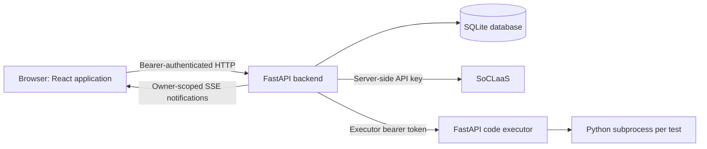

# CodeIt Developer Guide

This guide describes the implementation in this repository as reviewed on 28 October 2026. It accompanies the [User Guide](UserGuide.md) and [Reflections](Reflections.md), and addresses the additional engineering requirements in the [assignment brief](../assignment-brief.md).

## 1. Product and scope

CodeIt is a Python programming assignment platform with three roles.

| Role | Core features | SoCLaaS AI feature |
| --- | --- | --- |
| Admin | Manage accounts, classes and memberships; inspect assignment statistics | Generate a narrative summary of assignment progress |
| Teacher | Maintain a personal question bank; create and manage class assignments | Generate, revise and approve question drafts |
| Student | Solve assigned questions; run visible tests; submit against all tests; revisit submissions | Request a hint, optionally with a specific question |

The runtime hint feature uses bounded LLM tool calls. The specialized development agents are a separate software engineering workflow; the application does not run those development agents.

## 2. Architecture



The frontend uses React, TypeScript, React Router, TanStack Query, Tailwind CSS and CodeMirror. Vite builds static files; the frontend Docker image serves them through Nginx with SPA route fallback. Both Python services use FastAPI, Pydantic and HTTPX, with Python 3.14 or later required by their package manifests.

The backend owns accounts, authorization, persistence, AI orchestration and submission records. The executor accepts code and test cases from the backend and returns deterministic judging results. Only the backend holds the SoCLaaS API key; browser configuration contains the public API origin.

### Module responsibilities and shared components

| Location | Responsibility |
| --- | --- |
| `backend/app/main.py`, `config.py` | App factory, startup/shutdown, environment configuration, bootstrap admin and service clients |
| `backend/app/auth.py`, `routers/auth.py` | Password verification, opaque bearer sessions and role dependencies |
| `backend/app/routers/` | HTTP validation, role and object access checks, dispatch to repositories/jobs |
| `backend/app/repos/` | Shared, parameterized SQL and database row conversion |
| `backend/app/schemas.py` | Shared request, response and AI draft validation models |
| `backend/app/jobs/` | Common job lifecycle, deduplication, timeout handling and SSE notifications |
| `backend/app/ai/` | Hint tool loop, question generation, summaries, guardrails and Markdown system prompts |
| `backend/app/clients/` | SoCLaaS and executor HTTP contracts and safe failure handling |
| `backend/app/judging.py` | Visible/all-test selection, hidden-result redaction and submission persistence |
| `code-execution/app/` | API/auth, job queue, subprocess runner, resource limits, output comparison and traceback sanitization |
| `frontend/src/api/`, `auth/` | Shared API client, query keys, session storage and authentication lifecycle |
| `frontend/src/jobs/`, `events/` | Shared asynchronous job state and SSE-driven query refresh |
| `frontend/src/components/` | Reusable layout, role guard, forms, Markdown, errors and status displays |
| `frontend/src/features/` | Role-specific screens and API hooks |

This separation applies SRP: routers authorize requests, repositories perform database access, and clients handle upstream services. DRY is especially important for the three role implementations: they share schemas, guards, repositories and one job runner instead of duplicating those mechanisms.

### Data model

The authoritative schema is [backend-schema.sql](../backend/backend-schema.sql). Accounts have many sessions and belong to classes through `class_members`. Teachers own questions with ordered test cases. Assignments belong to classes and refer to one to three questions through `assignment_questions`. Submissions belong to a student and an assignment/question pair; jobs retain asynchronous inputs, results and status.

SQLite uses WAL mode, foreign keys and a busy timeout. Constraints enforce unique usernames/class names, question ordering and job deduplication. A partial unique index permits at most one `in_process` job for each `(user_id, kind, target_key)`. A unique `source_job_id` prevents approving one generated draft twice.

Assignments reference editable question records rather than immutable snapshots. Editing a question changes it wherever it is assigned; existing submissions are not automatically rejudged. A question in use cannot be deleted, and a question with submissions cannot be removed from an assignment. Deleting an assignment cascades to its submissions; deleting a class also removes its assignments and memberships. Deleting a teacher leaves question/assignment creator references null.

### Asynchronous jobs and frontend state

Run, submit, hint, question generation and assignment summary all follow:

```text
POST action -> in_process -> success(result) or failed(safe error)
                      -> owner-scoped SSE notification -> GET updated job
```

A newly created job returns HTTP 202 with `created: true`. A duplicate in-progress action returns HTTP 200 with `created: false` and the existing job; the new input is ignored. Checking a job never starts work. Target keys are `a<assignment>:q<question>` for run/submit/hint, `a<assignment>` for summaries, and `-` for question generation.

SSE carries identifiers rather than source code or results. The frontend refetches the affected queries and reconciles job responses so an older response cannot replace a newer job or revert a completed job to `in_process`. It uses one event stream per tab rather than periodic job polling. Reconnection refreshes relevant state.

Jobs and the SSE hub execute in memory in one backend process, while job records persist in SQLite. Startup marks interrupted jobs failed; it does not resume them. Keep the backend at **one Uvicorn worker**. Multiple backend workers/replicas require a shared queue and event system before they are safe. The executor also uses one worker because its semaphore is process-local.

## 3. Local setup

### Docker Compose

Install Docker with Compose. From the repository root, create the service environment files if they do not already exist:

```bash
cp -n backend/.env.example backend/.env
cp -n code-execution/.env.example code-execution/.env
```

Edit these files locally; do not commit secrets. Set a valid `SOCLAAS_API_KEY`, select an available tool-capable `LLM_MODEL`, and replace `EXECUTOR_TOKEN` with the same private value in both files. The backend checks model availability through `/v1/models` during startup, so even local Docker startup needs a reachable SoCLaaS service and a valid key. The example selects `x-test-4`; the Python settings fallback is `coder`. Availability alone does not establish tool-call support: verify that separately for student hints.

Keep `APP_ENV=dev` for this local stack. Choose the bootstrap admin password explicitly. The example has `BOOTSTRAP_ADMIN_USERNAME=admin` and `BOOTSTRAP_ADMIN_PASSWORD=change-me`; bootstrap runs before demo seeding, so that admin uses the configured password rather than `demo1234`.

```bash
docker compose up -d --build
docker compose ps
docker compose logs --tail=100 backend
curl http://localhost:8000/api/health
```

Open `http://localhost:5173`. The API is at `http://localhost:8000`; development API documentation is at `/docs`. The executor has no published host port. Compose overrides its backend URL to `http://code-executor:8001` and mounts the SQLite volume at `/data`.

Compose starts containers in dependency order but does not define readiness health checks. Inspect startup logs if the API is not ready immediately. `docker compose down` stops the stack while preserving its named database volume; `docker compose down -v` deletes that database and should only be used when intentionally resetting disposable data.

### Running services directly

Use Linux for the executor: it relies on Unix resource limits, process groups, `/proc` and `pidfd`. Use Python 3.14+, `uv`, and Node.js/npm; the frontend Docker build uses Node 24. Create the backend and executor `.env` files as above, then copy `frontend/.env.example` to `frontend/.env` if needed.

In separate terminals:

```bash
# Terminal 1
cd code-execution
uv sync
WORK_ROOT=/tmp/codeit-executor uv run uvicorn app.main:app --port 8001 --workers 1
```

```bash
# Terminal 2: set CODE_EXECUTION_SERVER=http://localhost:8001 in backend/.env
cd backend
uv sync
DATABASE_PATH=./dev.db uv run uvicorn app.main:app --port 8000 --workers 1
```

```bash
# Terminal 3
cd frontend
npm ci
npm run dev
```

Direct execution is useful for debugging; it does not provide the container/network restrictions in Compose. Use the containerized executor when testing untrusted submissions. Exported shell environment variables override `.env`; this precedence previously caused a live integration failure described in the reflection.

### Configuration reference

| Variable | Meaning |
| --- | --- |
| `APP_ENV` | `dev` seeds demo accounts and exposes API docs; `prod` disables both and requires an HTTPS executor URL. Defaults to `dev`. |
| `DATABASE_PATH` | SQLite path; default `/data/app.db`. Use a writable local path for direct development. |
| `SESSION_TTL_HOURS` | Session lifetime; default 12 hours. |
| `BOOTSTRAP_ADMIN_USERNAME`, `BOOTSTRAP_ADMIN_PASSWORD` | Create an initial admin if none exists; changing these does not reset an existing admin. |
| `SOCLAAS_BASE_URL`, `SOCLAAS_API_KEY` | Server-side gateway configuration; the client tolerates a trailing `/v1`. |
| `LLM_MODEL` | One model shared by the three AI features; must support hint tool calls. |
| `LLM_JOB_TIMEOUT_S` | Overall AI job deadline and chat HTTP timeout; default 300 seconds. |
| `CODE_EXECUTION_SERVER`, `EXECUTOR_TOKEN` | Executor endpoint and shared bearer secret. |
| `MAX_CONCURRENT_JOBS`, `QUEUE_TIMEOUT_S` | Executor concurrency and slot wait; defaults 100 and 30 seconds. |
| `WORK_ROOT` | Executor temporary directory, `/work` in Compose. |
| `VITE_API_BASE_URL` | Public backend origin without `/api`, embedded into frontend assets at build time. |

Additional executor limits are defined in [config.py](../code-execution/app/config.py). The concurrency default is a configuration value, not a demonstrated capacity guarantee; size it against available memory/CPU and load-test the chosen deployment.

## 4. AI context, guardrails and resource use

| Feature | Context and boundaries | Work budget before HTTP retries |
| --- | --- | --- |
| Student hint | Starts with title and optional student question; model may retrieve current code and question/visible tests through two allowlisted tools. No hidden tests. | Initial completion plus at most three tool rounds; final round uses `tool_choice=none`; 1,024 output tokens per completion |
| Teacher generation | Difficulty, topics, teacher prompt; revision includes the selected parent draft and feedback. JSON is validated as `QuestionDraft`. | Up to two completions, with one repair attempt for invalid output; 16,384 output tokens per completion |
| Admin summary | Database-derived aggregate statistics for current class students; no student names or source code | One completion; 512 output tokens |

The SoCLaaS client retries HTTP 429/503 twice after 2 and 5 seconds. Other HTTP/network failures become a generic user-facing service error. The overall job timeout bounds the operation, including retries. These measures reduce failure amplification but **do not implement a global requests-per-minute limiter** across users. The repository does not establish the service's current quota or prove quota compliance under load; deployment must verify the account's limits and add shared throttling if required.

Prompt templates live in `backend/app/ai/prompts/`. Shared guards scan new hint inputs and generation prompts/feedback/topics before a job is created. Untrusted text is wrapped with per-job nonce tags; nested imitation tags are stripped repeatedly. The system prompt treats tagged text and tool results as data. A random canary detects one class of prompt leakage. Hint output is capped at 4,000 characters and long fenced code blocks are replaced; summary output is capped at 2,000 characters. These are layered mitigations, not proof that every injection or complete-solution leak is prevented.

Frontend Markdown rendering disables raw HTML, filters unsafe URL schemes, opens links with protective attributes and renders images as links. Generated question outputs and reference solutions require human checking: generation validates structure but does not execute the reference solution against its tests before approval.

## 5. Security and verification

| Boundary | Implementation | Relevant tests |
| --- | --- | --- |
| Account/session | Argon2id hashes; random opaque tokens stored only as SHA-256 hashes; expiry and password-change session invalidation; same unknown-user/bad-password response | `backend/tests/test_auth.py` |
| Role/object authorization | Server-side role dependencies plus ownership/class membership checks; inaccessible objects usually return 404 | `test_admin.py`, `test_teacher.py`, `test_student.py`, `test_auth.py` |
| Hidden-test confidentiality | Student views/hint tools receive visible tests only; submit output removes hidden stdout/stderr and hidden failure messages | `backend/tests/test_student.py` |
| AI input/output | Injection scan, nonce wrapping, canary check, bounded tool loop, output length/code checks and schema validation | `test_guards.py`, `test_student.py`, `test_teacher.py`, `test_admin.py` |
| Executor API | Shared bearer token and 16 MiB body limit | `code-execution/tests/test_api.py` |
| Submitted programs | Separate process/session per test, resource limits, minimal child environment, capped output and process-group cleanup | `test_security.py`, `test_verdicts.py`, `test_concurrency.py` under `code-execution/tests/` |
| Browser content/session | Safe Markdown rendering, cache clearing on logout, handling of stale 401 responses | Frontend `Markdown.test.tsx`, `session.test.ts`, `client.test.ts` |

The executor container runs as a non-root user with a read-only root filesystem, writable tmpfs, dropped capabilities, `no-new-privileges`, PID/memory/CPU limits and an internal network without outbound internet. The child process does not inherit the executor bearer token. Tests stop at the first failure to avoid unnecessary execution.

The subprocess runner is not a separate container or OS user per submission. It does not establish complete isolation between mutually hostile programs sharing the executor container. Existing tests cover specific attacks, not arbitrary sandbox escape or cross-job access. Treat stronger sandbox isolation as a production security gap. CORS is currently permissive, authentication tokens are stored in browser local storage, and there is no application-wide login/AI rate limiter or audit trail.

### Running checks

Run each command in the indicated service directory:

```bash
# backend/
uv sync
uv run pytest
```

```bash
# code-execution/ on Linux
uv sync
uv run pytest
```

```bash
# frontend/
npm ci
npm test
npm run lint
npm run build
```

Backend tests use a temporary database and mock SoCLaaS/executor HTTP, so they need neither live credentials nor running services. Executor tests run real Python submissions. Frontend tests exercise state helpers, API/session handling and safe Markdown; they are not a browser end-to-end suite.

Historical logs report 130 backend tests at the end of backend implementation, 131 after the co-teacher endpoint, 57 executor tests, and 36 frontend tests at the teacher-page milestone. These are dated observations, not freshly verified totals for this documentation change. Re-run checks on the release commit and retain the actual results. Use the [User Guide walkthrough](UserGuide.md#7-reproducible-peer-testing-walkthrough) for manual integration checks, including all three AI roles. Also test a real tool-capable SoCLaaS completion: mocks cannot verify gateway/model compatibility.

## 6. Spec-driven and multi-agent development

The detailed contracts are [backend-spec.md](../specs/backend-spec.md), [code-execution-spec.md](../specs/code-execution-spec.md), and the [frontend specification](../specs/frontend/frontend-spec.md) with login/admin/teacher/student supplements. They define API contracts, access rules, job states, limits and test expectations before implementation. Approved clarifications are written back to the specs and then implemented and tested.

The recorded backend workflow builds the shared foundation first, fans out three role implementers with disjoint ownership, then runs independent spec and security verifiers. Findings return to the original file owner, with at most two verification rounds. The orchestrator resolves ambiguous requirements with the human and runs final integration checks after writers finish. The executor and frontend logs describe spec-driven work in individual sessions rather than claiming that every component used multi-agent implementation.

### Workflow artifact index

| Artifact | Purpose |
| --- | --- |
| [Foundation agent](../.claude/agents/backend-foundation.md) | Shared-core scope, ownership, handoff format and completion criteria |
| [Role implementer](../.claude/agents/backend-role-implementer.md) | Per-role ownership, minimal context sequence and escalation contract |
| [Spec verifier](../.claude/agents/spec-verifier.md) | Independent read-only spec/test conformance review and structured findings |
| [Security verifier](../.claude/agents/security-verifier.md) | Independent read-only auth, confidentiality, AI guardrail and secret review |
| [Backend handoff](../workflow/backend-implementation/HANDOFF.md) | Shared APIs, fixtures and examples for role agents; originally referred to in prompts as `backend/HANDOFF.md` |
| [Backend log](../logs/backend-implementation.md) | Coordination phases, defects, review outcomes, live checks and resource measurements |
| [Executor log](../logs/code-executor-implementation.md) | Spec changes, sandbox implementation and test results |
| [Frontend log](../logs/frontend-implementation.md) | Login/admin and teacher work, decisions, tests and co-teacher follow-up |
| [Python skill](../.agents/skills/python-general/SKILL.md) | Repository guidance for Python implementation |
| [Commit skill](../.agents/skills/commit/SKILL.md) and its `agents/openai.yaml` | Commit grouping/format instructions and skill metadata |
| [Web design skill](../.claude/agents/skills/web-design/SKILL.md) | Available frontend design guidance |
| [CLAUDE.md](../CLAUDE.md) | Local assistant context; does not replace the product specs |

Agent definitions remain in `.claude/agents/` and skills in their discovery directories so the tools can find them naturally. Historical handoff paths in prompts must be reconciled with the current `workflow/` location before reusing those prompts. The existing logs are implementation summaries, not a proven complete archive of every development interaction. The reflection discusses their measurement limits and the recorded secret-access instruction violation.

## 7. Deployment and development/production separation

The checked-in Compose stack is a **local development configuration**: it builds a localhost API URL into the frontend and uses HTTP to the internal executor. Setting only `APP_ENV=prod` will make backend startup reject that executor URL. No production deployment manifest, CI/CD workflow, public application URL or GitHub Pages website configuration was found in this repository snapshot. The frontend README mentions Render build configuration, but that is not evidence of an active deployment.

For a release, prepare a separate deployment configuration with these properties:

1. Separate dev/prod environment values, SoCLaaS credentials, executor tokens, bootstrap credentials and database volumes. Explicitly set `APP_ENV=prod`; never rely on the default.
2. Build the frontend with the public HTTPS backend origin. Its API URL is compiled into JavaScript; changing runtime environment values alone does not update it.
3. Provide TLS for browser/API traffic and an HTTPS executor endpoint reachable by the backend, while restricting executor access and preserving runtime hardening. Keep the executor's network isolated from arbitrary outbound access.
4. Persist and back up the production SQLite database. Use SQLite-aware backups or stop writes for a consistent backup that accounts for WAL; do not copy only the live main database file.
5. Use one backend worker, preserve SSE through the proxy, and configure proxy timeouts for long AI jobs. Smoke-test login, reconnects, judging and all AI roles after deployment.
6. Manage deployment through the team's own hosting/automation, as required by the brief. Record the deployed commit, test results, public application URL and rollback procedure; retain compatible database backups before schema changes.

The brief also requires a public organization repository named `CS3227-2610-MP4`, an up-to-date `master`, a GitHub Pages product website, workflow artifacts and interaction summaries. Current source lives in `backend/`, `frontend/` and `code-execution/`, whereas the brief requests `src/…`. Reconcile that layout with the submission requirements before grading. Team membership, individual contributions, previous-MP non-reuse and external deployment status cannot be established from these source files alone.

## 8. Acknowledgements

The [CS3227 assignment brief](../assignment-brief.md) supplies the project requirements and reflection questions. The [backend development log](../logs/backend-implementation.md) credits the course's L8 Multi-Agent Coordination material for the orchestrator/subagent and generator/verifier patterns. [soclaas-docs.md](../backend/soclaas-docs.md) records the SoCLaaS API reference used for integration; it is reference material, not application-authored API documentation.

The application uses the open-source packages declared in the [backend manifest](../backend/pyproject.toml), [executor manifest](../code-execution/pyproject.toml) and [frontend manifest](../frontend/package.json), including FastAPI, Uvicorn, Pydantic Settings, aiosqlite, argon2-cffi, HTTPX, React, Vite, React Router, TanStack Query, CodeMirror, Tailwind CSS, react-markdown, remark-gfm and fetch-event-source. pytest, pytest-asyncio, respx, Vitest, TypeScript and oxlint support verification. Docker images build on Python, Node and Nginx images identified in their Dockerfiles.

The frontend log identifies Vite template defaults as the basis for its TypeScript configuration. Claude-assisted implementation and verification are recorded in the development logs; this documentation was drafted with Codex assistance using the brief, source, specs and those logs. The repository does not provide a complete third-party snippet/template provenance inventory. Before submission, team members should confirm any further reused ideas, code, assets or documentation and add their original sources here; absence of a recorded source is not evidence of original authorship.
