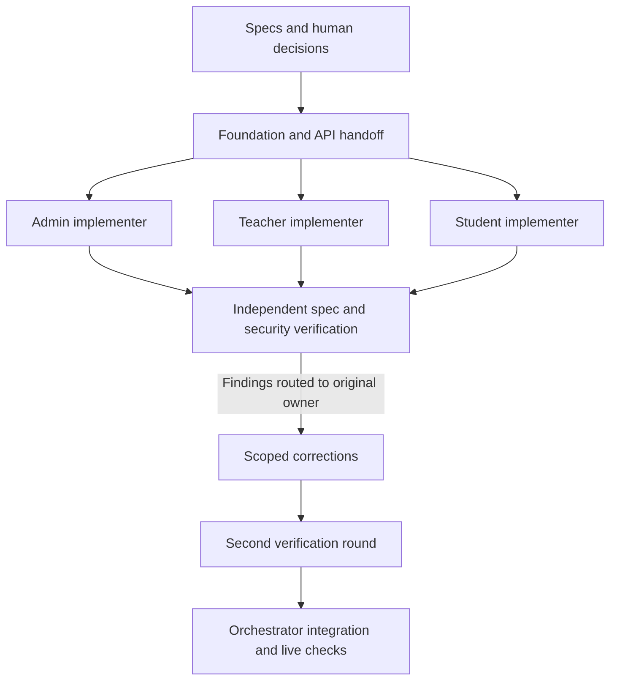
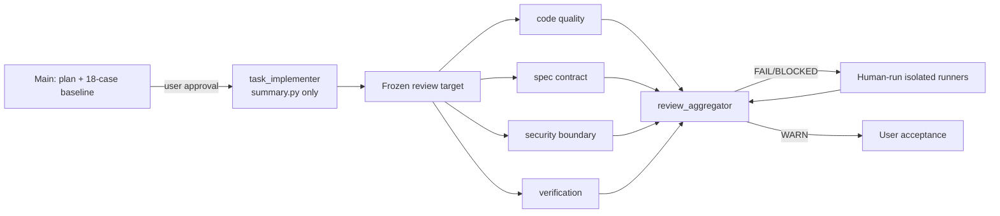

## Reflections on Multi-Agent SE, Context Engineering and Resource-aware Use by Theodore Lim

This reflection analyzes the development evidence available in the repository. Its main sources are the [backend log](../logs/backend-implementation.md), [executor log](../logs/code-executor-implementation.md), [frontend log](../logs/frontend-implementation.md), [agent definitions](../.claude/agents/backend-role-implementer.md) and [backend handoff](../workflow/backend-implementation/HANDOFF.md). Recorded measurements are historical observations, not experiments rerun for this document. Interpretations and proposed improvements are identified separately from measured outcomes.

## 1. Coordination worked best after shared interfaces were stable

The backend used an orchestrator–subagent pattern followed by a generator–verifier loop. A foundation agent implemented shared schemas, repositories, authentication, jobs, clients, guards and fixtures first. Three role implementers then worked concurrently on admin, teacher and student modules. Finally, two independent agents checked spec conformance and security, returning findings to the original owners. The verification loop was capped at two rounds.

Disjoint file ownership was the main conflict-control mechanism. Role agents could edit only their router, feature implementation, prompt and tests. Shared schemas and repositories belonged to the foundation agent. If a role needed a shared change, it had to report the exact request instead of adding SQL or duplicate models locally. The log records no foundation requests from the three role agents. This supports the conclusion that the shared contract was sufficient for this particular decomposition; it does not establish that the same approach would work for tightly coupled features.

The phase gate also had a cost: role work waited until the foundation was built and its 71 tests passed. The recorded foundation phase took 14.3 minutes, while role implementation took 1.1, 1.9 and 2.4 minutes. The foundation was the critical path. Simply adding more role agents would not have reduced that dependency.

There is no per-agent utilization trace, so we cannot calculate idle or overloaded time. We can identify structural waiting at the foundation gate and later review gates. The bounded role scopes and zero reported foundation requests suggest little blocking during role implementation, but they do not prove that agents were continuously productive.

## 2. Independent verification caught shared misunderstandings

The first spec review found that the student hint loop could make an extra tool round. The implementer's test encoded the same misunderstanding, so self-verification passed. This is a concrete example of why a passing test written alongside a feature does not necessarily establish conformance: both can share one mistaken interpretation.

The security reviewer found that stripping imitation untrusted-content tags once could let nested tags reconstruct themselves. Repeating the stripping until stable fixed the issue, and the current guard tests cover nested tags. The process also exposed requirement gaps: co-teacher assignment editing and whether the hint title needed untrusted wrapping. These went to the human/orchestrator for a spec decision, then back to implementers.

This conflict-resolution path was useful because it separated a code defect from an ambiguous requirement. The verifier supplied a section reference and owner; the human resolved product behavior; the orchestrator updated the specification; the owner changed the implementation. A verifier's preference did not silently become a new requirement.

Verification itself needed scrutiny. In round two, the spec verifier incorrectly reported that no test covered hint-title wrapping; the orchestrator found the test. Both verifiers also missed a flaky assertion and a live startup problem. Independent review increased coverage, but did not remove the need to spot-check findings or exercise the real system.

## 3. Recorded experiments and what they establish

| Experiment or observation | Recorded result | Analysis and limit |
| --- | --- | --- |
| Shared foundation before role fan-out | 71 foundation tests; no foundation requests from role agents; integrated suite reached 124 tests | Consistent with a useful handoff and ownership split. No no-handoff control run was recorded. |
| Generator tests versus independent reviewers | First review failed; extra hint tool round and nested-tag stripping defect found | Independent review caught errors that implementation tests missed. It does not measure all missed defects. |
| Repeated tests for suspected instability | Hidden-value assertion failed about once in seven runs; after correction, eight full runs each reported 126 passes | Random nonce/canary text could accidentally contain a short hidden value such as `40`. Assertions should inspect the relevant payload rather than search an entire randomized request. |
| Mocked integration versus real startup | 126 tests and two reviews missed a doubled `/v1/v1/models` path; live startup failed | Mocks were too permissive, and an exported environment value differed from `.env`. Base URL normalization and four exact-URL tests brought the logged suite to 130. |
| Reusing reviewers for scoped rechecks | Spec review: 24 → 4 tool calls, 3.7 minutes → 50 seconds; security review: 29 → 5 calls, 3.9 minutes → 53 seconds | About 83% fewer calls in each recheck. Scope was also smaller, so this cannot isolate a benefit from context reuse or caching. |
| Live tool compatibility | Logged `coder` response invoked `get_code`; 0.9 seconds and 361 tokens | Establishes tool use for that model/key at that time. It does not validate every model or current gateway availability. |
| Executor adversarial tests | 57 tests passed in about 15 seconds on Linux | Covered resource limits, output floods, inherited secrets, child cleanup and file limits. This is not a general sandbox-escape proof. |

The live startup failure is particularly informative. An earlier gateway check read `.env` directly, while the application used settings where shell variables take precedence. Both checks seemed reasonable but tested different configurations. A better release check must start the actual application with the actual deployment environment, then exercise its endpoints. Exact HTTP URL assertions improve mocks, but only live checks cover credentials, model support and deployment routing together.

Repeated full-suite execution was justified once a flaky failure appeared. It would be wasteful as a default policy after every edit. Targeted tests should be used during implementation, one full suite after writers finish, and additional repetitions only when instability gives a reason.

## 4. Multi-agent benefits had a measurable review cost

The backend log reports these cumulative subagent token counts:

| Agent | Model label in the log | Tokens |
| --- | --- | ---: |
| Foundation | opus | 171.3k |
| Admin implementer | sonnet | 56.0k |
| Teacher implementer | sonnet | 69.2k |
| Student implementer | sonnet | 76.7k |
| Spec verifier | opus | 148.2k |
| Security verifier | opus | 132.1k |
| **Total** | | **653.5k** |

Generators account for approximately 57.1% and verifiers 42.9% of that total. Verification was a substantial part of the resource budget. Its value is supported by the concrete defects and spec gaps it found; however, the record has no equivalent single-agent implementation with matched scope, model settings and quality criteria. We therefore cannot claim a measured net speedup, monetary saving or reduction in total defects from multi-agent development.

For the initial role phase, sequential recorded durations sum to 5.4 minutes and the longest is 2.4 minutes. Ideal overlap could reduce that phase by about three minutes, excluding orchestration and contention. This is an estimate from the run record, not a measured end-to-end parallel-versus-sequential comparison. The much longer foundation phase limits its effect on total delivery time.

One coordination inefficiency was explicit: role agents ran full suites while other agents were still writing. Those results described moving snapshots and could not serve as the final integration gate. A clearer instruction would reserve the authoritative full-suite run for the orchestrator after all writers report completion. Individual agents should report targeted results and any remaining assumptions.

The failed attempt to launch a newly defined custom agent also consumed avoidable effort: the session had not loaded its definition. The workaround used a general-purpose agent that read the definition. Checking agent availability before starting a coordinated run would make the trigger mechanism more reliable.

Multi-agent work is most suitable here for independent role modules and independent review perspectives. A small UI wording change or a tightly coupled shared-core edit would usually gain little from splitting across agents. The executor and frontend logs show useful spec-driven progress without asserting parallel implementation for those components.

## 5. Context engineering reduced discovery work, but needs maintenance

The foundation handoff recorded module APIs, schema names, repository signatures, job behavior, fixtures and a usage example. Role agents were told to read the handoff and their assigned spec sections before opening implementation files. The reported handoff was 102 lines, below its 150-line limit. This gave implementers an executable contract without requiring each to reconstruct the whole backend.

Upfront context was most valuable for stable constraints: file ownership, public APIs, authorization rules, shared job semantics, test fixtures and how to report a blocked dependency. Detailed implementation internals were retrieved only when needed. The role prompts also required a structured final report with files, tests, foundation requests and spec issues, making handoffs easier to assess.

There is now a context-maintenance issue: agent definitions still refer to `backend/HANDOFF.md`, while the retained artifact is under `workflow/backend-implementation/HANDOFF.md`. Historical prompt paths are not necessarily current instructions. Before reusing the workflow, the entry points should be synchronized so agents do not waste time searching or infer that the contract is missing.

The record does not include a controlled experiment showing that extra context harmed performance. It does show a related retrieval hazard: the frontend log's first section says teacher/student pages were placeholders, but later sections and the current source implement them. Supplying only the first summary would produce an incorrect product description. Historical logs should be labeled by scope/date, while current contracts and source should determine present behavior.

A continuation note should record the current objective, accepted decisions, owned files, exact interfaces, pending findings, commands and results, relevant commit, blockers and next action. It should distinguish observations from guesses and omit secrets. Persisting these facts avoids repeated exploration without pretending to preserve private model reasoning.

## 6. Model choice and resource measurements need stronger evidence

The recorded workflow assigned opus to the foundation and verifiers, and sonnet to bounded role implementation. This was a task-based allocation: shared-core mistakes propagate to all roles, while role work has narrower contracts. The observed token counts and durations are consistent with a lighter role phase, but task complexity differs too much to attribute the difference solely to model choice. The record contains model-family labels rather than exact immutable model versions or a matched model comparison.

Returning fixes to the same agent and giving reviewers only the changed scope avoided some repeated discovery. Foundation corrections reportedly needed two calls and 37 seconds; the teacher correction needed two calls and 34 seconds. These are useful continuation observations, not measured cold-start savings for identical tasks.

Prompt-cache hit rates, cached-input tokens, cache misses and internal reasoning tokens were not recorded. Consequently, we cannot answer the brief's cache-saving or reasoning-percentage questions numerically. The 57.1%/42.9% split above measures generator/verifier work, **not** reasoning versus visible tokens. The live completion's 361-token observation is also not enough to infer that breakdown.

A useful next experiment would compare the same bounded task with a handoff versus repository exploration, and separately compare a resumed reviewer with a fresh reviewer on the same diff. Record exact model/version, input/output/cached tokens when exposed, wall time, calls, retries and independently assessed defects. Repeat tasks before drawing causal conclusions. Keep stable instructions in a consistent prefix to make caching possible, but report actual provider cache statistics before claiming savings.

By cumulative role, the foundation was the largest consumer at 171.3k tokens; together, the two verifiers consumed 280.3k. Future optimization should target repeated repository discovery and unnecessarily broad review scopes before weakening security review. The existing scoped second round is evidence that review breadth can be reduced after a complete first pass.

## 7. The application applies context and work budgets directly

Student hints start with a compact request and retrieve question/code only if the model asks. The tools expose visible tests, not hidden tests, and take no arbitrary resource IDs. This reduces upfront context and narrows access. It can still cost more calls if the model requests both sources repeatedly; without production usage telemetry, the net token saving is unmeasured.

The hint loop permits an initial completion plus three tool rounds, with a final `tool_choice=none`, and limits each completion to 1,024 output tokens. Question generation allows one JSON repair attempt and currently permits 16,384 output tokens per completion; a revision includes the parent draft, so this feature can consume substantial context. Summaries use compact aggregate data with a 512-token output cap rather than sending students' source code or identities. These values describe current code; they should not be inferred from older spec snapshots.

The common job runner deduplicates simultaneous matching actions and imposes a deadline. The SoCLaaS client bounds retries for 429/503 to two retries with backoff. The executor limits concurrent jobs, times out its queue and stops testing at the first failure. These controls bound work locally, but retry limits and deduplication do not enforce the gateway's overall request quota across different users/actions. A shared quota limiter and telemetry remain necessary to demonstrate behavior under load.

No runtime experiment in the logs measures context-size savings, model-quality tradeoffs, prompt-cache benefits or gateway quota compliance. Those should remain proposed measurements rather than retrospective claims.

## 8. Security must be enforced beyond prompt instructions

Application security combines server-side roles and membership checks, hidden-test redaction, scoped tools, input scanning, nonce-tagged untrusted text, canaries and output validation. The independent security review improved that design by finding nested-tag reconstruction. Still, a regex injection detector and a canary cover only some attacks, and the long-code filter cannot guarantee that a hint never reveals a complete solution.

The development process exposed the same distinction between instruction and enforcement. The foundation agent was told not to access `backend/.env`, yet the log records an `awk` check against it. The report says only a yes/no value was printed and no secret was disclosed. That does not make the boundary reliable: the file access itself violated the instruction. The log proposed a deny rule; the repository evidence does not establish that the rule was installed or tested.

Future runs should make secret files inaccessible through actual tool permissions, supply `.env.example` and synthetic values for ordinary work, and isolate live credential checks from implementers. Read-only verifier tool sets and explicit ownership reduce accidental mutation, but shell access can be broader than the written role description. Their real permissions need testing as well.

Similarly, the executor's resource limits and hardened container are useful controls, but all submissions share a service container and OS user. The existing tests do not prove isolation against arbitrary hostile programs. A production security claim requires stronger submission isolation and adversarial evaluation, along with authentication/AI rate controls and deployment verification.

## 9. Changes to carry into the next development cycle

1. Synchronize handoff paths and verify agent availability before launch; keep ownership, accepted spec decisions and current state concise.
2. Run targeted tests during concurrent implementation, then one authoritative integrated suite after writers finish. Repeat only when a failure or instability warrants it.
3. Keep independent security/spec review for boundary-sensitive work, route fixes to their owners, and spot-check verifier claims.
4. Add exact upstream-contract assertions and exercise real startup plus all three AI features using deployment-equivalent configuration.
5. Enforce secret/file restrictions through permissions and validate those restrictions with synthetic secrets.
6. Measure cache use, model versions, token categories, retries and task quality before claiming efficiency improvements; compare equivalent tasks rather than different agent roles.
7. Add shared SoCLaaS quota control, stronger executor isolation and a separate production deployment, then record the resulting security and load-test evidence.

The strongest supported lesson is that clear contracts and independent checks complement each other. The handoff let role agents work with few reported dependencies; verification exposed mistaken interpretations; repeated tests and a real startup check caught failures outside those reviews. The evidence supports retaining that combination while measuring its costs more carefully.

---

## Reflections on Multi-Agent SE, Context Engineering and Resource-aware Use by Teo Keng Jer

This reflection covers my work on the Admin role's AI feature: making the AI cohort summary reliable, then fixing it again after it failed against the live model. Sources are the [task brief](../workflow/tasks/admin-summary-response-reliability.md), [planning delta](../workflow/planning/admin-summary-response-reliability.md), [security closeout](../workflow/reviews/admin-summary-task1-security-closeout.md), [verification runners](../workflow/scripts/README.md) and the three dated records in `workflow/implementations/admin-summary-*`. Figures are copied from those records. I did not rerun anything for this document.

### 1. Coordination pattern: one writer, a frozen target, a review panel

For Task 1 (reject unusable summary responses), I used a fixed pattern. The main agent did planning and baseline measurement. One `task_implementer` was the only writer, and its production scope was a single file (`backend/app/ai/summary.py`). Four read-only reviewers then assessed the same fixed target: code quality, spec/contract, security boundary and verification. A `review_aggregator` merged their verdicts. Writers were frozen during review, and at most two correction passes were allowed.

The handoff told the implementer what it must **not** touch: the shared LLM client, guards, repositories, schema, canonical specs and frontend. It also told it to stop and ask if a shared change looked necessary. None was needed. The 512-token cap, retry policy and API shape stayed unchanged, and the spec reviewer confirmed that only `summary.py` changed in production.

To check that the coordination pattern was actually followed, I relied on observable artefacts, not on agent self-reports. The review target was identified by commit plus diff. Each axis had to supply exactly one report. The aggregator's verdict had to cite each child's verdict. Because the reviewers were read-only, any change between rounds could only have come from the writer.

### 2. Where the agents were blocked: on evidence, not on code

The first aggregate verdict was **FAIL/BLOCKED**, but no code defect had been found. The reviewers ran in a sandbox without a usable Docker engine or Python toolchain. They could not execute the tests or the Semgrep scan, so the verification and security axes had no evidence to judge.

This was the main idle/blocked point in my workflow. Re-dispatching the panel would only have reproduced the same block and spent more tokens. Instead, I wrote two PowerShell runners (`run-admin-summary-baseline.ps1`, `run-admin-summary-semgrep.ps1`). They build allowlisted source snapshots into disposable containers, use `--network none` for tests and save structured evidence (JUnit, JSON, logs). Reviewers then inspected the saved evidence and did not rerun it. That resolved finding `VR-task1-pass1-1` and the scan gate. The final aggregate became **WARN**, which the user accepted as **PASS WITH LIMITATIONS**.

What I learned: in a multi-agent setup, "who can actually run the checks" is a coordination decision and should be made before dispatch. Reviewers that cannot execute can still give useful judgement on saved evidence. However, someone must produce that evidence reproducibly. The trade-off is trust: reviewers judged records they did not rerun, and the closeout says so explicitly.

### 3. Experiment: baseline-first contract tests

Before any implementation, I wrote 18 contract cases (AC-01 to AC-08) for the proposed acceptance gate. I ran them against the unchanged code with **no xfail markers**, so gaps showed up as ordinary failures.

| Measurement | Before | After |
| --- | --- | --- |
| Original 18-case contract | 7 passed / 11 failed | 18 / 18 |
| Supplemental validation cases | n/a | 16 / 16 |
| Full backend regression | n/a | 168 / 168 in 90.87 s |
| Ruff, mypy, offline build | n/a | all exit 0 |
| Semgrep (106 files) | n/a | 2 pre-existing Medium wildcard-CORS findings, 1 partial-parse limitation |

The baseline made the spec executable. "Reject blank, truncated, tool-call, oversized and canary-leaking output" became 11 visible failing tests. The implementer's success criterion was then unambiguous. The original 18 cases were kept unchanged as a contract, and new tests went into a separate file so they could not weaken the original expectations.

### 4. Experiment: mocked acceptance versus the live model

Task 1 passed every mocked check, yet the feature failed in use. The user later reported live rejections. Because the validator rejected without logging content, the cause was invisible, so I added diagnostics in a separate step. They log only fixed reason literals (eight rejection codes, 14 test cases) and never model text or metadata values. The controlled live observations were:

| Live attempt | First rejection reason |
| --- | --- |
| Original prompt, 512 tokens | `word_limit` (over 150 words) |
| Shorter prompt, 512 tokens | first succeeded, then `finish_length` |
| Shorter prompt, 768 tokens | `word_limit` |

The 150-word hard cap was a value I chose. It was tested with synthetic boundary fixtures that proved the mechanics, not that the live model could stay within it. The SoC model kept overshooting a "100–120 words" instruction. When I tightened the token budget to stop that, the model was cut off mid-sentence instead. With user approval, I separated the **generation target** (still 100–120 words) from the **hard acceptance ceiling** (now 250 words and 2,000 characters), and set the budget to 768 tokens. The canary check, `finish_reason == stop`, no tools and nonempty text all remained mandatory.

Two lessons:

- **Strict validation trades availability for safety.** Rejecting instead of truncating or "repairing" was correct for security. It also saved quota, because a repair call would cost another SoCLaaS request. However, every rejection forces a manual regeneration, which uses a request anyway. A hard limit should be calibrated on real model output before it becomes a contract.
- **Privacy-preserving diagnostics are a context-engineering tool.** Fixed reason codes gave me enough signal to change the right parameter without storing student-derived prose or canary values.

To make regeneration less painful, the final change keeps the previous successful summary visible, labelled with its original timestamp, while a new one runs or after one fails.

### 5. Context engineering: dated addenda instead of rewriting history

The task brief went through several phases: proposal, approval, implementation, acceptance and then a superseding policy. Rather than editing old text, I appended dated addenda that state what they supersede ("This dated record supersedes the 150-word hard acceptance threshold…"). The original experiment files stayed unchanged as evidence for the *earlier* policy.

This kept the history auditable. It also created the risk Theodore described in §5: an agent that reads only the top of the brief sees an outdated contract. Two mitigations helped. The current contract was also written into `specs/backend-spec.md` §7.3, which is the source of truth. Each implementation record also begins with a status line and a baseline commit. Upfront in the handoff I supplied the owned files, forbidden files, exact error string, precedence order of checks and the test command. I left the implementer to retrieve source details itself.

A handoff should also say what was **not** verified. My 13 November backend records say plainly that pytest, Ruff and mypy were unavailable in that environment. Only AST syntax checks and `git diff --check` ran, and full runtime verification is listed as pending with exact commands. That costs a few lines. It prevents the next agent, or a grader, from assuming a green suite.

### 6. Resource-aware use

- **Model calls in the app:** the summary feature makes exactly one call per request, with no tools and no repair attempt. Every focused test asserts one request and the configured `max_tokens`, so a future change cannot silently add calls.
- **Agent resources:** reviewers inspected saved evidence instead of each re-running a 90-second suite inside a sandbox where it would fail. Semgrep and the full suite ran once per target, not once per reviewer.
- **What I could not measure:** per-agent input, cached, output and reasoning tokens were not captured for these sessions. The verification report records them as *unavailable*, not zero. I cannot give a cache-hit rate or a reasoning percentage for my tasks. Junhao's telemetry below covers that question for the sessions it captured.

### 7. When multi-agent coordination was worth it

For Task 1, the four-axis panel was justified. The change touched a security boundary (canary handling and untrusted provider output), and independent reviewers confirmed that no new security defect was introduced. For the 13 November follow-ups (a constant change, diagnostic logging and a component-local UI fix), I worked single-agent and stated "no independent review claimed" in each record. Running five agents over a one-constant diff would have cost more than the risk justified. My rule of thumb now: use the panel when the change crosses a trust boundary or a shared contract, and use a single agent with honest self-reporting for local, reversible changes.

---

## Reflections on Multi-Agent SE, Context Engineering and Resource-aware Use by Neo Jun Hao

My work covered the Student role's AI features (submission complexity analysis, and the hint generator–reviewer pair) plus team tooling: the skill-evaluation and telemetry harness (`workflow/evals/`), the agent write-scope guard (`workflow/agent-scope/`), the live-AI probes (`workflow/live-ai/`) and the Pi staging deployment. Every number below comes from a committed report. The eval runs used one trial (n = 1) to three trials per cell, so small differences are indicative, not significant.

### 1. Coordination pattern and what four review rounds revealed

The complexity feature followed the same pattern teokj describes: a planner brief, one `task_implementer`, four specialist reviewers and an aggregator. It needed **four** review runs before reaching an acceptable verdict:

| Run | Aggregate | What blocked it |
| --- | --- | --- |
| 1 | FAIL | Semgrep failed (`ca-certs: empty trust anchors`); offline backend build lacked cached `setuptools`; real findings on migration serialization and missing focused guard tests |
| 2 | FAIL | Verification still blocked (sandbox denied uv cache); one Medium spec-reference finding |
| 3 | FAIL | Verification blocked: browser acceptance and reproducible packaging |
| 4 | WARN | No open findings; live-provider and revocation-timing evidence incomplete |

Only run 1 produced code defects. Runs 2 and 3 failed because reviewers in a sandbox could not reproduce what the implementer had done outside it. That waiting was structural: the reviewers were idle on evidence, the same pattern teokj hit. In hindsight, I should have resolved the sandbox, cache and certificate problems before dispatching the panel. Two of the four rounds were spent on the environment, not the change.

Multi-agent review did catch real issues (migration serialization, stale spec references, a missing guard test). For the follow-up "few-shot prompt plus three format retries" change, I deliberately worked **single-agent with self-review**. It was a small, coupled change to one function, already covered by tests and backed by a live A/B result. A five-agent round for it would have been mostly overhead.

### 2. Prompt boundaries are requests; I built an enforced one

Role prompts said "reviewers write only under `workflow/reviews/`" and "never touch `.env`". Theodore's log shows a foundation agent reading `.env` despite such an instruction. So I made the boundary a policy file plus an enforcer:

- `scope.toml` is a human-authored allow/block list per role (block wins; reviewers can write nothing outside their reports).
- `guard.py guard` is a live `PreToolUse(Bash)` hook that exits 2 on an out-of-scope shell write.
- `guard.py audit <role> --baseline <commit>` is the **authoritative** check, run against the diff after a role returns.

The design came from a limitation I found while building it: Codex's `PreToolUse` hook sees Bash commands but **not** `apply_patch` edits. A live hook alone would therefore give a false sense of security. The diff audit catches writes made by any route. The guard also produced a false positive: it flagged text inside here-doc bodies as write targets. I fixed that (commit `87bb23b`) and added a test. After integrating the audit with the telemetry, the report states that no delegated role wrote outside its scope in the captured sessions. That is a measured property of those sessions, not a guarantee for future ones.

### 3. Context engineering experiments

I built `workflow/evals/` so that skills and prompts could be compared on fixed cases, with deterministic checks plus three semantic judges. Four experiments bear directly on the brief's questions.

**(a) Does extra context make an agent less effective?** (`implement-task` experiment-008: same task, fresh workspace versus a "crowded" workspace full of unrelated material)

| Case | Score | Worker time | Uncached input | Cached input | Reasoning | Cost |
| --- | ---: | ---: | ---: | ---: | ---: | ---: |
| fresh | 94 | 1m 38s | 40,628 | 341,504 | 495 | $0.0096 |
| crowded | 94 | 5m 47s | 162,937 | 3,038,848 | 3,196 | $0.0534 |

Quality was unchanged, but the crowded run took **3.5× the time and 5.6× the cost**, with about 9× more cached input and 6.5× more reasoning. In this case, extra context did not show up as a quality drop. It showed up as resource cost, and that cost would go unnoticed unless measured. The signal was the cached-input count and wall time, not the score.

**(b) Does instruction position matter?** (experiment-010: one key requirement placed at the beginning, middle or end of a long brief, plus a short brief.) All four scored 100, at $0.0068–$0.0076 each. At this brief length, I found no lost-in-the-middle effect. The cheaper lever was length, not position.

**(c) Structured versus flexible task briefs.** Flexible briefs looked better in isolation. In `plan-task`, the flexible-brief version improved 4 of 7 cases and was generally cheaper. But when an implementer continued from those briefs (experiment-007, 18 trials each), structured briefs scored **95.6** against **89.6** for flexible, at near-identical cost. In experiment-006, one flexible-brief trial implemented code despite "Plan only; do not implement". I therefore reverted to structured briefs (`3b78ea7`). The lesson: evaluate a handoff document by how well the **next** agent performs, not by how good the document looks.

**(d) Inlining a skill's referenced files.** In `code-review` (experiment-002 → 003), I embedded the skill's referenced files so the agent did not open them one by one:

| Case | Score | Time | Uncached input | Reasoning | Cost |
| --- | --- | ---: | ---: | ---: | ---: |
| authorization | 99 → 100 | −36.6% | −2.1% | −49.1% | −17.4% |
| validation | 99.67 → 100 | −32.3% | −46.2% | −55.9% | −38.0% |

For a skill whose references are always needed, supplying them upfront beat retrieving them as needed, cutting time by about a third and reasoning by about half. That only holds when the references are always needed; experiment (a) shows the cost of supplying context that is not.

One evaluation caveat: experiment-006 first reported 13/36 passes. Most "failures" were judges that never produced a JSON verdict. Regrading the same worker outputs (experiment-007) gave 35/36. Evaluation infrastructure needs verifying as much as the agents do. Otherwise a broken judge looks like a regression.

### 4. Measured resource use, cache behaviour and reasoning share

The telemetry hook captured my real Codex sessions (API-equivalent estimates, not actual spend):

- **10 sessions, 86 subagents, $23.73 estimated.** One session, porting the MP3 workflow setup with 36 subagents, accounted for **$22.56 (95%)**. The 45 ad-hoc built-in subagents cost $7.87, against $1.6 for all 33 offline eval experiments (278 trials) combined. Broad, loosely scoped fan-out was by far the largest cost; focused, configured roles were cheap.
- **96.9% cache hit** (177.1M cached versus 5.6M uncached input tokens). Every session starts with the same `AGENTS.md` prefix, and skills are loaded as stable blocks, so most input was a cache hit. The remaining waste was uncached exploration, which experiment (a) shows grows with workspace clutter.
- **Reasoning share** (reasoning ÷ billed output): 9.2% in experiment-010, 20.8% in experiment-008 (and 23.7% for the crowded case alone), and 9–19% in code-review. Reasoning grew with ambiguity and clutter, not with task size. Persisting decisions into briefs and handoffs (the structured-brief result) is the practical form of "persisted reasoning": the next agent reads a conclusion instead of re-deriving it.
- **Per-skill cost** (attributed from single-skill turns only, so it is indicative): verification-review $1.32, spec-contract-review $1.06, commit $0.99, code-quality-review $0.98, security-boundary-review $0.65. Review dominated skill cost, which matches Theodore's 42.9% verifier share.

### 5. Resource-aware model choice for the app's AI features

Model selection was done **per feature** against the live SoCLaaS catalogue, using the real prompts and guards.

- **Our own concurrency looked like model failure.** At concurrency 16, many models showed 0/21 valid responses with errors after about 7 s. That was 429 rate-limiting caused by us. At concurrency 8 the same models recovered (`x-test-2`: 0/21 → 14/21). A separate status probe found 16 of 17 models returning HTTP 200. The app's single `UserFacingError` type hid this distinction, so I had to probe raw statuses.
- **The global default was unusable for complexity.** `coder` timed out at 45 s on 21/21 calls, so complexity got its own `complexity_model` setting.
- **Prompt technique mattered more than model.** In a 6-variant A/B, few-shot moved `qwen3.6:35b` from 8/21 to **21/21** valid and correct, and was also the fastest variant. Chain-of-thought and lenient parsing did not help.
- **Reliability and security pulled in opposite directions.** `ornith1.5:35b` won the reliability ranking (17/21), but it was breached 6/100 times with guards on (19/100 with guards off), while `qwen3.6:35b` with guards on was 0/100. I shipped `qwen3.6:35b` with the few-shot prompt and up to three format retries inside the job timeout. Each retry uses a fresh nonce and canary, and a canary leak fails immediately, so retries cannot be used to probe for the canary.

For hints: generator `qwen3-coder-next` (fast, 0 full-solution leaks) and reviewer `nemotron3.5:30b` (a different model family, to avoid correlated errors). As a generator, `nemotron3.5:30b` recited its system prompt and canary in 5 of 6 reproductions. As a reviewer, its output is only a `{is_hint, reveals_answer}` verdict, so that weakness is contained.

### 6. Security of the AI features, tested live

- **Complexity:** nine attacks across five injection types. The keyword scanner blocked exactly 50/100 calls per model. Keyword-free obfuscation and indirect attacks passed it and relied on the model and the output canary.
- **Hints:** 330 calls over two untrusted channels. **No hidden-test leak in any run**, because `get_question` filters hidden tests before the model sees them. Enforcing at the tool boundary was the most effective control. Payload splitting across the code and question fields evaded the per-field scanner. Nemotron's canary leak was caught by the output canary check, so it became a failed request rather than a disclosure.
- **Generator–reviewer:** the deterministic 5-line code strip caught 1/9 bad hints. LLM reviewers caught 6–7/9 with 0/7 false positives. A later live probe found a reviewer **false negative** on a complete working solution. The user accepted that risk and deferred mitigation, so the reviewer is documented as a mitigation, not an enforcement guarantee.

### 7. Development/production separation

Pushes to `master` deploy automatically to a staging stack on the Raspberry Pi that is isolated from production, with its own database, port and TLS settings in a separate Compose overlay. Production shares only the executor-limit configuration. The frontend fails over from the Pi API to a Render backend when the Pi is unavailable, retrying safe reads only; the Render backend has a separate database. Two deployment fixes became process rules: **promote before post-deploy health checks**, and **leave a failed staging deploy in place for diagnosis** instead of rolling it back automatically, so the evidence survives.

### 8. What I would keep and change

Keep: per-feature live model selection; enforced write scope with a diff audit; structured briefs judged by downstream performance; the telemetry hook (it showed that one session was 95% of cost). Change: fix the reviewer sandbox before dispatching a panel (two of four complexity review rounds were spent on environment problems); cap ad-hoc subagent fan-out; record the exact model version and cache statistics for every eval so comparisons stay valid across sessions.
