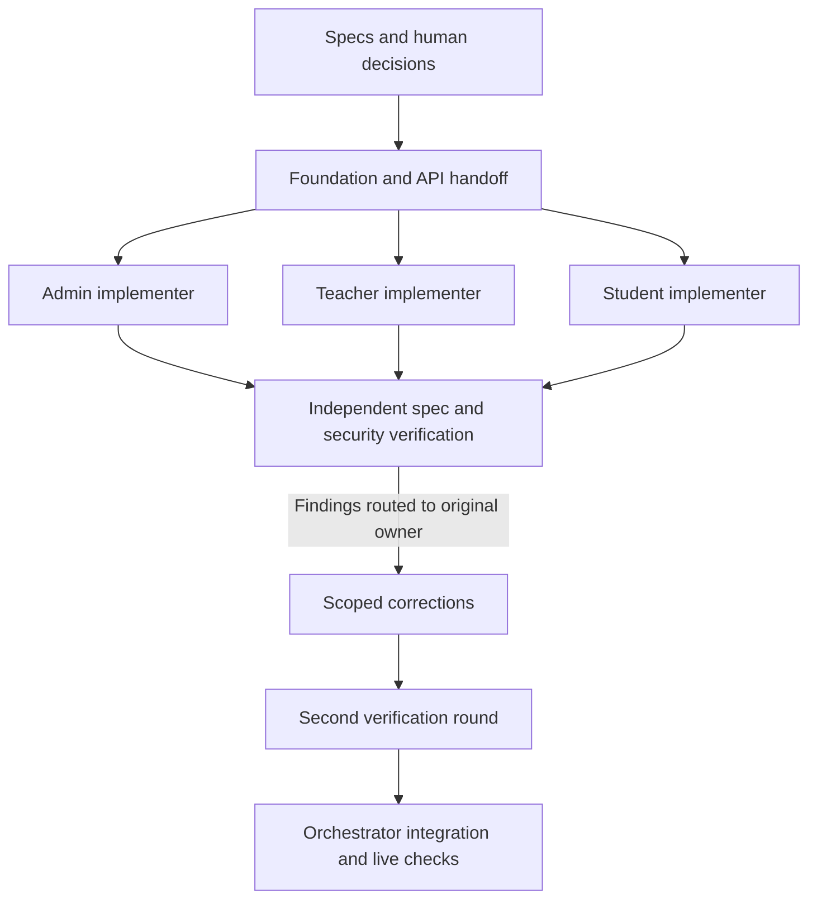
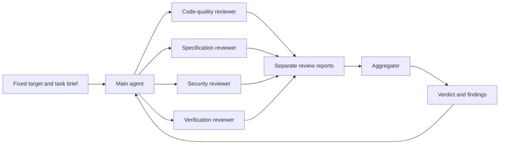

## Reflections on Multi-Agent SE, Context Engineering and Resource-aware Use by Theodore Lim

This reflection analyzes the development evidence available in the repository. Its main sources are the [backend log](../logs/backend-implementation.md), [executor log](../logs/code-executor-implementation.md), [frontend log](../logs/frontend-implementation.md), [agent definitions](../.claude/agents/backend-role-implementer.md) and [backend handoff](../workflow/backend-implementation/HANDOFF.md). Recorded measurements are historical observations, not experiments rerun for this document. Interpretations and proposed improvements are identified separately from measured outcomes.

## 1. Coordination worked best after shared interfaces were stable

The backend used an orchestrator–subagent pattern followed by a generator–verifier loop. A foundation agent implemented shared schemas, repositories, authentication, jobs, clients, guards and fixtures first. Three role implementers then worked concurrently on admin, teacher and student modules. Finally, two independent agents checked spec conformance and security, returning findings to the original owners. The verification loop was capped at two rounds.

Disjoint file ownership was the main conflict-control mechanism. Role agents could edit only their router, feature implementation, prompt and tests. Shared schemas and repositories belonged to the foundation agent. If a role needed a shared change, it had to report the exact request instead of adding SQL or duplicate models locally. The log records no foundation requests from the three role agents. This supports the conclusion that the shared contract was sufficient for this particular decomposition; it does not establish that the same approach would work for tightly coupled features.

The phase gate also had a cost: role work waited until the foundation was built and its 71 tests passed. The recorded foundation phase took 14.3 minutes, while role implementation took 1.1, 1.9 and 2.4 minutes. The foundation was the critical path. Simply adding more role agents would not have reduced that dependency.

There is no per-agent utilization trace, so we cannot calculate idle or overloaded time. We can identify structural waiting at the foundation gate and later review gates. The bounded role scopes and zero reported foundation requests suggest little blocking during role implementation, but they do not prove that agents were continuously productive.

## 2. Independent verification caught shared misunderstandings

The first spec review found that the student hint loop could make an extra tool round. The implementer's test encoded the same misunderstanding, so self-verification passed. This is a concrete example of why a passing test written alongside a feature does not necessarily establish conformance: both can share one mistaken interpretation.

The security reviewer found that stripping imitation untrusted-content tags once could let nested tags reconstruct themselves. Repeating the stripping until stable fixed the issue, and the current guard tests cover nested tags. The process also exposed requirement gaps: co-teacher assignment editing and whether the hint title needed untrusted wrapping. These went to the human/orchestrator for a spec decision, then back to implementers.

This conflict-resolution path was useful because it separated a code defect from an ambiguous requirement. The verifier supplied a section reference and owner; the human resolved product behavior; the orchestrator updated the specification; the owner changed the implementation. A verifier's preference did not silently become a new requirement.

Verification itself needed scrutiny. In round two, the spec verifier incorrectly reported that no test covered hint-title wrapping; the orchestrator found the test. Both verifiers also missed a flaky assertion and a live startup problem. Independent review increased coverage, but did not remove the need to spot-check findings or exercise the real system.

## 3. Recorded experiments and what they establish

| Experiment or observation | Recorded result | Analysis and limit |
| --- | --- | --- |
| Shared foundation before role fan-out | 71 foundation tests; no foundation requests from role agents; integrated suite reached 124 tests | Consistent with a useful handoff and ownership split. No no-handoff control run was recorded. |
| Generator tests versus independent reviewers | First review failed; extra hint tool round and nested-tag stripping defect found | Independent review caught errors that implementation tests missed. It does not measure all missed defects. |
| Repeated tests for suspected instability | Hidden-value assertion failed about once in seven runs; after correction, eight full runs each reported 126 passes | Random nonce/canary text could accidentally contain a short hidden value such as `40`. Assertions should inspect the relevant payload rather than search an entire randomized request. |
| Mocked integration versus real startup | 126 tests and two reviews missed a doubled `/v1/v1/models` path; live startup failed | Mocks were too permissive, and an exported environment value differed from `.env`. Base URL normalization and four exact-URL tests brought the logged suite to 130. |
| Reusing reviewers for scoped rechecks | Spec review: 24 → 4 tool calls, 3.7 minutes → 50 seconds; security review: 29 → 5 calls, 3.9 minutes → 53 seconds | About 83% fewer calls in each recheck. Scope was also smaller, so this cannot isolate a benefit from context reuse or caching. |
| Live tool compatibility | Logged `coder` response invoked `get_code`; 0.9 seconds and 361 tokens | Establishes tool use for that model/key at that time. It does not validate every model or current gateway availability. |
| Executor adversarial tests | 57 tests passed in about 15 seconds on Linux | Covered resource limits, output floods, inherited secrets, child cleanup and file limits. This is not a general sandbox-escape proof. |

The live startup failure is particularly informative. An earlier gateway check read `.env` directly, while the application used settings where shell variables take precedence. Both checks seemed reasonable but tested different configurations. A better release check must start the actual application with the actual deployment environment, then exercise its endpoints. Exact HTTP URL assertions improve mocks, but only live checks cover credentials, model support and deployment routing together.

Repeated full-suite execution was justified once a flaky failure appeared. It would be wasteful as a default policy after every edit. Targeted tests should be used during implementation, one full suite after writers finish, and additional repetitions only when instability gives a reason.

## 4. Multi-agent benefits had a measurable review cost

The backend log reports these cumulative subagent token counts:

| Agent | Model label in the log | Tokens |
| --- | --- | ---: |
| Foundation | opus | 171.3k |
| Admin implementer | sonnet | 56.0k |
| Teacher implementer | sonnet | 69.2k |
| Student implementer | sonnet | 76.7k |
| Spec verifier | opus | 148.2k |
| Security verifier | opus | 132.1k |
| **Total** | | **653.5k** |

Generators account for approximately 57.1% and verifiers 42.9% of that total. Verification was a substantial part of the resource budget. Its value is supported by the concrete defects and spec gaps it found; however, the record has no equivalent single-agent implementation with matched scope, model settings and quality criteria. We therefore cannot claim a measured net speedup, monetary saving or reduction in total defects from multi-agent development.

For the initial role phase, sequential recorded durations sum to 5.4 minutes and the longest is 2.4 minutes. Ideal overlap could reduce that phase by about three minutes, excluding orchestration and contention. This is an estimate from the run record, not a measured end-to-end parallel-versus-sequential comparison. The much longer foundation phase limits its effect on total delivery time.

One coordination inefficiency was explicit: role agents ran full suites while other agents were still writing. Those results described moving snapshots and could not serve as the final integration gate. A clearer instruction would reserve the authoritative full-suite run for the orchestrator after all writers report completion. Individual agents should report targeted results and any remaining assumptions.

The failed attempt to launch a newly defined custom agent also consumed avoidable effort: the session had not loaded its definition. The workaround used a general-purpose agent that read the definition. Checking agent availability before starting a coordinated run would make the trigger mechanism more reliable.

Multi-agent work is most suitable here for independent role modules and independent review perspectives. A small UI wording change or a tightly coupled shared-core edit would usually gain little from splitting across agents. The executor and frontend logs show useful spec-driven progress without asserting parallel implementation for those components.

## 5. Context engineering reduced discovery work, but needs maintenance

The foundation handoff recorded module APIs, schema names, repository signatures, job behavior, fixtures and a usage example. Role agents were told to read the handoff and their assigned spec sections before opening implementation files. The reported handoff was 102 lines, below its 150-line limit. This gave implementers an executable contract without requiring each to reconstruct the whole backend.

Upfront context was most valuable for stable constraints: file ownership, public APIs, authorization rules, shared job semantics, test fixtures and how to report a blocked dependency. Detailed implementation internals were retrieved only when needed. The role prompts also required a structured final report with files, tests, foundation requests and spec issues, making handoffs easier to assess.

There is now a context-maintenance issue: agent definitions still refer to `backend/HANDOFF.md`, while the retained artifact is under `workflow/backend-implementation/HANDOFF.md`. Historical prompt paths are not necessarily current instructions. Before reusing the workflow, the entry points should be synchronized so agents do not waste time searching or infer that the contract is missing.

The record does not include a controlled experiment showing that extra context harmed performance. It does show a related retrieval hazard: the frontend log's first section says teacher/student pages were placeholders, but later sections and the current source implement them. Supplying only the first summary would produce an incorrect product description. Historical logs should be labeled by scope/date, while current contracts and source should determine present behavior.

A continuation note should record the current objective, accepted decisions, owned files, exact interfaces, pending findings, commands and results, relevant commit, blockers and next action. It should distinguish observations from guesses and omit secrets. Persisting these facts avoids repeated exploration without pretending to preserve private model reasoning.

## 6. Model choice and resource measurements need stronger evidence

The recorded workflow assigned opus to the foundation and verifiers, and sonnet to bounded role implementation. This was a task-based allocation: shared-core mistakes propagate to all roles, while role work has narrower contracts. The observed token counts and durations are consistent with a lighter role phase, but task complexity differs too much to attribute the difference solely to model choice. The record contains model-family labels rather than exact immutable model versions or a matched model comparison.

Returning fixes to the same agent and giving reviewers only the changed scope avoided some repeated discovery. Foundation corrections reportedly needed two calls and 37 seconds; the teacher correction needed two calls and 34 seconds. These are useful continuation observations, not measured cold-start savings for identical tasks.

Prompt-cache hit rates, cached-input tokens, cache misses and internal reasoning tokens were not recorded. Consequently, we cannot answer the brief's cache-saving or reasoning-percentage questions numerically. The 57.1%/42.9% split above measures generator/verifier work, **not** reasoning versus visible tokens. The live completion's 361-token observation is also not enough to infer that breakdown.

A useful next experiment would compare the same bounded task with a handoff versus repository exploration, and separately compare a resumed reviewer with a fresh reviewer on the same diff. Record exact model/version, input/output/cached tokens when exposed, wall time, calls, retries and independently assessed defects. Repeat tasks before drawing causal conclusions. Keep stable instructions in a consistent prefix to make caching possible, but report actual provider cache statistics before claiming savings.

By cumulative role, the foundation was the largest consumer at 171.3k tokens; together, the two verifiers consumed 280.3k. Future optimization should target repeated repository discovery and unnecessarily broad review scopes before weakening security review. The existing scoped second round is evidence that review breadth can be reduced after a complete first pass.

## 7. The application applies context and work budgets directly

Student hints start with a compact request and retrieve question/code only if the model asks. The tools expose visible tests, not hidden tests, and take no arbitrary resource IDs. This reduces upfront context and narrows access. It can still cost more calls if the model requests both sources repeatedly; without production usage telemetry, the net token saving is unmeasured.

The hint loop permits an initial completion plus three tool rounds, with a final `tool_choice=none`, and limits each completion to 1,024 output tokens. Question generation allows one JSON repair attempt and currently permits 16,384 output tokens per completion; a revision includes the parent draft, so this feature can consume substantial context. Summaries use compact aggregate data with a 512-token output cap rather than sending students' source code or identities. These values describe current code; they should not be inferred from older spec snapshots.

The common job runner deduplicates simultaneous matching actions and imposes a deadline. The SoCLaaS client bounds retries for 429/503 to two retries with backoff. The executor limits concurrent jobs, times out its queue and stops testing at the first failure. These controls bound work locally, but retry limits and deduplication do not enforce the gateway's overall request quota across different users/actions. A shared quota limiter and telemetry remain necessary to demonstrate behavior under load.

No runtime experiment in the logs measures context-size savings, model-quality tradeoffs, prompt-cache benefits or gateway quota compliance. Those should remain proposed measurements rather than retrospective claims.

## 8. Security must be enforced beyond prompt instructions

Application security combines server-side roles and membership checks, hidden-test redaction, scoped tools, input scanning, nonce-tagged untrusted text, canaries and output validation. The independent security review improved that design by finding nested-tag reconstruction. Still, a regex injection detector and a canary cover only some attacks, and the long-code filter cannot guarantee that a hint never reveals a complete solution.

The development process exposed the same distinction between instruction and enforcement. The foundation agent was told not to access `backend/.env`, yet the log records an `awk` check against it. The report says only a yes/no value was printed and no secret was disclosed. That does not make the boundary reliable: the file access itself violated the instruction. The log proposed a deny rule; the repository evidence does not establish that the rule was installed or tested.

Future runs should make secret files inaccessible through actual tool permissions, supply `.env.example` and synthetic values for ordinary work, and isolate live credential checks from implementers. Read-only verifier tool sets and explicit ownership reduce accidental mutation, but shell access can be broader than the written role description. Their real permissions need testing as well.

Similarly, the executor's resource limits and hardened container are useful controls, but all submissions share a service container and OS user. The existing tests do not prove isolation against arbitrary hostile programs. A production security claim requires stronger submission isolation and adversarial evaluation, along with authentication/AI rate controls and deployment verification.

## 9. Changes to carry into the next development cycle

1. Synchronize handoff paths and verify agent availability before launch; keep ownership, accepted spec decisions and current state concise.
2. Run targeted tests during concurrent implementation, then one authoritative integrated suite after writers finish. Repeat only when a failure or instability warrants it.
3. Keep independent security/spec review for boundary-sensitive work, route fixes to their owners, and spot-check verifier claims.
4. Add exact upstream-contract assertions and exercise real startup plus all three AI features using deployment-equivalent configuration.
5. Enforce secret/file restrictions through permissions and validate those restrictions with synthetic secrets.
6. Measure cache use, model versions, token categories, retries and task quality before claiming efficiency improvements; compare equivalent tasks rather than different agent roles.
7. Add shared SoCLaaS quota control, stronger executor isolation and a separate production deployment, then record the resulting security and load-test evidence.

The strongest supported lesson is that clear contracts and independent checks complement each other. The handoff let role agents work with few reported dependencies; verification exposed mistaken interpretations; repeated tests and a real startup check caught failures outside those reviews. The evidence supports retaining that combination while measuring its costs more carefully.

---

## Reflections on Multi-Agent SE, Context Engineering and Resource-aware Use by Teo Keng Jer

### 1. My responsibility and the reliability question

My primary responsibility was the Admin role, particularly AI assignment performance summaries, reliability improvements and integration testing. My contribution was to investigate how summaries failed, define and test a safer response contract, coordinate verification, and improve recovery when regeneration failed. The [accepted Admin task](../workflow/tasks/admin-summary-response-reliability.md) records the bounded change, while the [retained-result implementation](../workflow/implementations/admin-summary-retained-result-2026-11-13.md) records my subsequent frontend improvement.

The central question became more complicated than whether the model could produce a summary. I needed to establish whether the application accepted useful completed responses, rejected unusable ones safely, and preserved a usable experience when generation failed. My investigation showed that these are separate properties. A validator can correctly enforce a contract while rejecting ordinary model output too often. This distinction shaped what I learned about multi-agent verification, context engineering and resource budgets.

### 2. Experiment: validation exposed eleven contract failures

I first treated reliability as an observable contract problem. The original handler could accept blank output, disregard completion metadata and silently shorten oversized responses through a shared guard. I proposed summary-specific validation rather than changing that shared guard, which other AI features used. The [planning contract](../workflow/planning/admin-summary-response-reliability.md) defined acceptance criteria before implementation, and the [contract tests](../backend/tests/test_admin_summary_reliability.py) exercised the backend through mocked provider responses and temporary databases.

The historical experiment used source revision `818fd611` and an 18-case test set. I retained the original expectations through implementation; later formatting did not change their meaning. This matters because changing tests to match implementation would have weakened the comparison. The [security closeout](../workflow/reviews/admin-summary-task1-security-closeout.md) consolidates the executed results and their limitations.

| Historical experiment | Recorded result | What I could conclude |
| --- | --- | --- |
| Original contract against baseline source | 7 passed, 11 failed, no errors; 13.17 seconds | Existing handling violated eleven tested expectations. |
| Same contract after validation | 18/18 passed; 17.85 seconds | The scoped implementation met those mocked expectations. |
| Separate supplemental cases | 16/16 passed; 12.75 seconds | Additional boundaries and validation precedence behaved as expected. |
| Final formatted backend suite | 168/168 passed; 90.87 seconds | The identified historical target passed the recorded backend regression suite. |

The historical validator required a completed `stop` response, no tool calls, nonempty trimmed text, at most 150 words and at most 2,000 characters. It checked the full response for the canary before applying size checks, rejected excess instead of slicing it, and added no repair generation. The [supplemental tests](../backend/tests/test_admin_summary_validation.py) covered Unicode boundaries, malformed responses and combined failures, including canary precedence. They checked persisted status, safe errors and null failed results, rather than only a helper's return value.

I interpret 7/18 to 18/18 as improved conformance to a defined response contract. It is not a success-rate estimate for live generations, and the longer post-change duration is not evidence of a performance improvement. These were synthetic provider replies, not sampled model outputs. The experiment also excluded whether the prose interpreted ties, zero submissions or difficulty correctly. The improvement isolated a useful result: eleven contract failures became passing cases without relaxing the original expectations. It did not establish that the contract itself matched useful live output. I now treat choosing the right acceptance policy as a separate engineering decision from implementing it correctly.

### 3. Specialized review improved confidence but added overhead

For this boundary-sensitive change, I used an implementer followed by independent quality, specification, security and verification perspectives, then aggregation. The implementer owned only `summary.py` and supplemental tests. Main retained planning and runner responsibilities. Reviewers received fixed target identities and assigned artifacts after writers stopped. The [task handoff](../workflow/tasks/admin-summary-response-reliability.md) describes these responsibilities, while the [closeout](../workflow/reviews/admin-summary-task1-security-closeout.md) records their contributions and resulting verdict.

Each perspective answered a different question. Quality assessed whether the private validator remained cohesive. Specification review checked the acceptance criteria and unchanged surrounding contracts. Security examined authorization, aggregate privacy, canary precedence and resource boundaries. Verification challenged whether actual execution supported acceptance. Aggregation preserved these separate judgments instead of interpreting several positive reviews as a majority vote. The registered [agent profiles](../.codex/config.toml) made the triggering and responsibility split explicit; their existence alone would not prove they had executed, so the recorded handoffs and artifacts mattered.

The most consequential blocker concerned evidence rather than a discovered code defect. Initial attempts lacked uv and Docker in the agent environment and the available Python 3.11 was incompatible with the supported backend environment, and pytest was unavailable. Source-level smoke checks could not substitute for runtime integration. Verification therefore blocked acceptance until saved supported-environment executions were available. Security separately blocked on current-target scanner evidence. Resolving the first blocker did not automatically resolve the second.

Eventually, the recorded container executions supported runtime and quality checks. Semgrep completed with two pre-existing wildcard-CORS findings and a partial-parsing limitation. The final WARN, accepted as PASS WITH LIMITATIONS, retained those qualifications. I learned to distinguish an evidence gap, a newly introduced defect and an existing risk: they need different follow-up actions. This changed how I interpreted a blocked review. An implementation could be plausible while acceptance remained unjustified; sending it back for more coding would not resolve missing execution evidence. The record does not show reviewers arguing over the validator design. Independent reviewers inspected shared saved executions; they did not independently reproduce those runs.

Coordination was expensive. Four review axes had to fit available concurrency, so verification waited for a slot. Formatting corrections changed target identities; missing compact-return details prompted follow-up; a PowerShell reporting conversion error required recovering actual command results. Build-cache preparation and scanner setup added further work. I have no utilization trace proving idle time or a matched single-agent run proving net acceleration. For this change, I judge the specialist coordination worthwhile because verification and security preserved distinct acceptance gates that the other positive reviews could not satisfy. That is a qualitative judgment about confidence, not a measured productivity gain. I would use multiple agents again when a change crosses security, persistence and provider-contract boundaries. For routine wording or a small component-local edit, I would use one agent with targeted checks, adding a specialist only if a concrete uncertainty remained. More reviewers should answer additional questions, not repeat the same reading.

### 4. Context engineering through bounded packets and handoffs

The useful context was a precise task packet, not the entire development conversation. I supplied the approved contract, relevant specification sections, baseline evidence, owned files, exact error behavior and exclusions upfront. The implementer could reuse shared clients and guards but could not alter them. Statistical interpretation work was explicitly deferred. That prevented a response-validation investigation from expanding into unrelated architecture or product changes, and made a blocked dependency something to report rather than silently work around.

The [task brief](../workflow/tasks/admin-summary-response-reliability.md) and [planning record](../workflow/planning/admin-summary-response-reliability.md) provided persistent entry points. Fresh reviewer contexts received the same fixed requirements and evidence references, with unique output paths. Reviewers retrieved source relevant to their axis. The [aggregator profile](../.codex/agents/review_aggregator.toml) restricted aggregation to the roster and specialist artifacts, avoiding another source review. This gave me a clearer reason for selecting context: stable constraints belonged upfront because violating them could invalidate the work; detailed source belonged in retrieval because each reviewer needed a different subset. The bounded production diff and axis-specific returns were useful outcomes, although I cannot isolate how much the packets caused them.

Fresh contexts also had a cost: agents could not rely on unstated decisions from earlier conversation. A useful handoff therefore needed the current target, accepted decisions, owned files, commands and outcomes, open findings, blockers and next action. Hashes helped identify the reviewed snapshot, while compact returns helped scheduling. The follow-up needed for incomplete compact returns showed that naming an output format was insufficient. I would include a short return checklist and require each agent to distinguish executed checks from pending checks. I came to see a fresh context as a deliberate reset of assumptions that requires a stronger handoff, rather than a free efficiency improvement.

Historical records created another context hazard. The task retains earlier pending wording followed by its acceptance addendum; the November 13 policy later supersedes the 150-word threshold. Reading an isolated paragraph could produce the wrong current requirement. I would make the governing decision and superseded policy prominent in future packets and link detailed history underneath. I cannot claim a controlled reduction in tokens from fresh contexts, or prove that context overload caused poorer results. My thinking shifted from supplying more background to making authority easier to find: a short current-decision summary, explicit supersession links and a clearly identified next action would be more useful than another undifferentiated history.

### 5. Live failures changed my understanding of reliability

Later real SoCLaaS testing challenged the practical adequacy of the historical contract. As documented in the [November 13 policy record](../workflow/implementations/admin-summary-acceptance-policy-2026-11-13.md), my reported local sequence was: the original prompt failed with `word_limit`; a shorter prompt succeeded once but subsequently failed with `finish_length` at 512 tokens; increasing the allowance to 768 tokens still produced `word_limit`. The [diagnostic implementation](../workflow/implementations/admin-summary-live-rejection-diagnostics.md) used fixed rejection labels without logging response content or arbitrary provider metadata. Those labels identified the first failed gate, not exact response lengths or factual quality.

I responded by separating the preferred generation target from hard acceptance. The current prompt asks for 100–120 words, with a 120-word instruction ceiling. The preferred presentation remains at most 150 words, but the validator accepts up to 250 whitespace-delimited words and 2,000 Python Unicode characters after trimming. Generation has a 768-token output allowance. Full-response canary checking, exact `stop` completion, no tools and nonempty content remain mandatory, as specified in the [revised backend contract](../specs/backend-spec.md). Tokens, words and characters serve different purposes; raising one limit does not guarantee compliance with the others.

The November 13 implementation record predates my subsequent manual local testing. After the policy revision, I manually observed six successful live SoCLaaS summary generations locally. I include this as my reported observation, not as a result independently verified by the repository audit or the existing reviewers. Six successes provide encouraging local compatibility evidence, but cannot establish general reliability, production behavior or factual accuracy. I do not have a controlled representative sample or recorded usage analysis supporting those broader conclusions.

The old 18/18 and 168/168 results still describe the earlier policy. In particular, acceptance of 151 words intentionally changed, so those results cannot validate the revised contract unchanged. The live failures changed my next question from whether the validator enforced the rule to whether the rule rejected otherwise useful summaries. I learned that tightening rejection can improve contract compliance while reducing availability. The six successes support trying the revised tolerance, but do not isolate the effect of the prompt, token allowance or word limit. I would test both safety properties and acceptance of representative useful outputs, recording policy versions and varying one factor at a time where practical.

### 6. Resource tradeoffs, integration testing and improvements

Mock-first testing let me exercise failures repeatedly with zero application-model calls during the recorded Task 1 implementation/review run. I could deliberately reproduce malformed replies and boundary cases instead of waiting for a live model to emit them. Its value was repeatability and control; the later failures showed why I also needed a separate compatibility check. The summary sends aggregates rather than student source code or identities, performs one handler-level generation and adds no repair loop. The shared client still permits two retries for 429/503, with two- and five-second delays, so one handler invocation is not necessarily one HTTP attempt. The 300-second default job deadline bounds waiting. I now distinguish these configured ceilings from measured consumption: neither a request cap nor a deadline tells me how many tokens were used, how long ordinary calls took or whether shared quotas were respected.

Increasing 512 to 768 tokens raised the maximum output allowance by 50%. I accepted that bounded tradeoff to provide completion headroom, but cannot claim its actual latency or cost effect. A larger allowance could permit more output and longer calls, while an overly small one could waste an attempt through truncation. I would choose between them using completed useful responses per attempt alongside usage and latency, rather than assuming the smallest cap is always most efficient. I did not conduct a matched Admin model comparison; the application uses its configured model, with `coder` as the settings default. My personal agent-token consumption, cache savings, reasoning-token percentages and financial savings were not measured. Team telemetry and other feature experiments cannot fill those gaps for my work.

I also improved recovery through the [retained-result change](../workflow/implementations/admin-summary-retained-result-2026-11-13.md). Its separate mocked browser scenario passed regeneration, stale-result, network-error and account/assignment-boundary checks; the existing unit suite passed 54 tests. This improved continuity when generation failed without another model call, but did not test live backend behavior. Retention ends on remount or reload. The record also preserves repository-wide formatting failures and successful targeted formatting, rather than presenting every check as green.

Next time, I would preflight tooling before dispatch, narrow each review to its affected boundary, and generate a versioned evidence bundle automatically with source identity, commands, exits and limitations. After mocked acceptance, I would run a bounded repeated live study across representative assignment sizes and statistical edge cases, assessing factual correctness separately from acceptance. I would record exact models, attempts, latency, retries and exposed input/output/cache/reasoning counters, retaining missing fields as unknown. Equivalent-task comparisons would then support efficiency claims.

This project changed my approach from seeking agreement among agents to asking what evidence would justify the next decision. I would still use AI to implement and review bounded work, but I would choose the coordination effort deliberately, keep current decisions easy to retrieve, and test model compatibility separately from deterministic contracts. My responsibility remains to interpret the limits of those results and decide when further work is worth its resource cost.

---

## Reflections on Multi-Agent SE, Context Engineering and Resource-aware Use by Ng Jun Hao

### Introduction

My MP4 contribution focused on the student hint and complexity-analysis features, along with the agent workflow used to build and review them. I expected subagents to keep each task's context focused and let independent work happen in parallel. Through the project, I learned to look at the actual handoffs, delays, and resource use before deciding whether that coordination helped. I also learned that model output needs checks around it: a helpful-sounding answer can still reveal too much, and a passing test suite can still leave important behavior unverified.

### 1. Multi-Agent SE

#### Coordinating independent reviews

I designed our development workflow around an orchestrator and specialist subagents. The main agent prepared a task brief, selected the work to delegate, and passed a fixed target and relevant evidence to specialists. In code review, I separated the work into the four [review axes](../.agents/skills/code-review/references/review-axes.md):

| Review axis | Question |
| --- | --- |
| Code quality | Is the change maintainable and consistent with the surrounding code? |
| Specification and contracts | Does it meet the approved requirements and preserve the relevant contracts? |
| Security boundaries | Does it protect data and enforce access and trust boundaries? |
| Verification and evidence | Do the tests and other checks support the claims about the change? |

I chose review for parallel work because each axis asks a different question about the same fixed change. The reviewers mainly read the code, requirements, and evidence; they write their findings to separate report paths rather than editing the implementation. That makes their work easier to coordinate and reduces the risk of agents overwriting each other's changes. The workflow also pauses writers during review so the panel can assess a stable target. Verification can still involve shared resources such as test services and build caches, so read-heavy work does not remove every possible conflict.

After the reviewers finish, the aggregator reads their reports and returns a compact verdict and findings to the main agent. This keeps the raw reports out of the main context while leaving them available for inspection. My reasoning was similar to parallel programming: divide work into independent tasks, give each task clear ownership, and combine the results after they finish. Lecture 8's orchestrator–subagent pattern helped me understand why this works best when subtasks have few dependencies. I expected the parallel reviews to be faster, although the project did not include a matched single-agent run to measure that benefit.

I also separated implementation from review to give the reviewers a fresh look at the change. Each reviewer started with a fresh conversation and received the task, target, and relevant evidence, rather than the implementer's full conversation. I hoped this would reduce the chance of accepting the implementer's assumptions without checking them. [Jhaveri et al.](https://arxiv.org/abs/2604.02485) found confirmation bias in language-model hypothesis testing, while [Alexopoulos et al.](https://arxiv.org/abs/2603.18740) found that the framing of information could influence automated security code reviews. Those studies reinforced my reason for asking reviewers to check the code against the brief and evidence. They did not test our workflow, and separate contexts do not guarantee independent judgments: reviewers can still share model weaknesses or rely on the same incomplete information. I therefore treated their findings as prompts for verification and my own judgment.

#### What happened during the complexity feature review

The traces let me check what happened beyond the workflow description. They show the prompts sent to agents, their tool activity and replies, waits by the main agent, and the reports passed to the aggregator. The complexity-analysis review went through four rounds:

| Round | Verdict | What the review recorded |
| --- | --- | --- |
| [1](../workflow/reviews/student-complexity-run-1.md) | FAIL | Migration serialization and focused guard-test findings; the security scan and backend packaging were blocked. |
| [2](../workflow/reviews/student-complexity-run-2.md) | FAIL | One specification-reference finding remained; browser acceptance and packaging evidence were incomplete. |
| [3](../workflow/reviews/student-complexity-run-3.md) | FAIL | No open findings, but browser acceptance and reproducible backend packaging were still blocked. |
| [4](../workflow/reviews/student-complexity-run-4.md) | WARN | No open findings or blocked axis; live-provider and access-revocation timing evidence remained incomplete. |

The reviewers found issues worth fixing, while later rounds also spent time establishing whether the implementation evidence could be reproduced. I came to see that a well-separated review design still depends on a reliable shared environment and concise, usable handoffs. Next time I would prepare the scanner, build cache, and acceptance environment before dispatching the panel.

One finding helped me understand the value of a separate review. The code-quality reviewer noticed that the database migration checked the existing schema before acquiring its write lock. Two initializers could therefore make the same decision from an old schema and perform a redundant rebuild. The reviewer recommended checking again inside the lock and adding a concurrent-initialization test. This was a more specific concern than whether the new complexity feature worked in the ordinary path, and it gave the implementer a concrete correction to make. The [first review](../workflow/reviews/student-complexity-run-1.md) records the finding and its expected test.

The rounds also showed me how to handle a disagreement about evidence. The implementation handoff reported that packaging had passed outside the sandbox, while the verification reviewer could not reproduce it inside the sandbox because its cache was inaccessible. I treated the handoff as useful evidence from the implementer and kept the verification axis blocked until the reviewer could build the package independently. In the fourth round, the reviewer recorded a successful offline build. This distinction helped me avoid turning one agent's report into a claim that another agent had verified it.

The approved [task brief](../workflow/tasks/student-code-complexity-analysis.md) helped the reviewers assess the same product decisions. I scoped the feature to best-effort time and auxiliary-space estimates for a student's completed submission, with assumptions stated. I excluded draft code, hidden tests, execution, and grading decisions. The implementation checkpoint included backend and frontend suites and a browser flow with a fake AI provider. Seeing the final review's remaining warnings helped me distinguish those checks from live-provider and revocation evidence that we still needed.

#### Coordination overhead and waiting

The [telemetry](../workflow/evals/Jun%20Hao%20telemetry%20and%20eval%20report.html) made the overhead visible. The hint-reviewer session recorded 16 subagent spawns, and the initial complexity-analysis session recorded 27. Those are session counts, not counts of agents working at the same time or a direct measure of added cost. Still, the timelines show multiple handoffs, waits, and review activity around features with bounded scope. For work at our project's scale, I found that amount of coordination too heavy as a default. I would reserve parallel specialists for independent questions where a missed issue matters, especially security or contract boundaries. For a small, tightly connected change, I would keep one implementer and use a focused review. I chose that approach for the later complexity prompt and format-retry change.

I also learned to consider the workflow's **critical path**: steps that must finish before the whole task can move on. The reviewers can examine the change in parallel, but they first need an implementation to review, and the aggregator waits for their results. A blocked reviewer can therefore delay the verdict even if the others finish quickly. A concurrency limit can also force agents to wait for an available slot; my teammate recorded that happening to the verification reviewer in the admin-summary work. I also wondered whether shared service capacity could limit the benefit of running more agents at once. That remains a hypothesis: my development-session traces do not establish service throttling or measure the capacity available to each agent. In my complexity work, the recorded environment and verification blockers give me concrete reasons for delays.

In one complexity implementation span, the worker timeline lasted about 49 minutes while the main agent issued wait calls roughly a minute apart. That showed the parent waiting for the implementation; the worker's elapsed span alone could not tell me how much of its own time was idle. Another long waiting bar initially looked like an agent had been stuck for hours, but the events showed a completed response followed by a pause before my next message. I learned to inspect the sequence behind the chart before calling a delay blocked work or an unnecessary retry.

The trade-off is still a judgment. The reviews caught concrete problems and gave me separate evidence for security, contracts, quality, and verification. They also required dispatch, repeated review rounds, and follow-up. I did not run a matched single-agent implementation of the same feature, so I cannot calculate how much time or token use the panel added. Given the small scope of many of our changes, I would use one agent for routine work and bring in independent specialists when the change crosses a sensitive boundary or needs genuinely separate checks.

### 2. Context Engineering and Resource-aware Use

#### Agent profiles, skills and boundaries

I used agent profiles to give each subagent a clear role and starting point. For example, the [security reviewer profile](../.codex/agents/security_boundary_reviewer.toml) directs the agent to its review skill, limits its work to the security axis, and specifies the artifact it should return. The skill supplies the detailed review procedure; the task brief and evidence identify the particular change to examine. Keeping those instructions in separate files helped me give a fresh reviewer the context for its own job without copying the whole implementation conversation.

I also wanted the roles' write boundaries to have a check outside the prompt. I built a [role-based scope policy](../workflow/agent-scope/scope.toml) and [guard](../workflow/agent-scope/agent-scope.md), with a person responsible for deciding which paths each role may write. This follows the principle in AWS's [AGENTSEC03-BP03: Implement least privilege with dynamic boundaries](https://docs.aws.amazon.com/wellarchitected/latest/agentic-ai-lens/agentsec03-bp03.html): give an agent the access it needs for its role. In a recorded CLI probe, a pre-tool hook blocked a tested out-of-scope write. A later check uses recorded activity to surface possible scope violations, and the Stop hook refreshes the usage report. These records also connect to [AGENTOPS05-BP01: Establish end-to-end tracing and telemetry for agent operations](https://docs.aws.amazon.com/wellarchitected/latest/agentic-ai-lens/agentops05-bp01.html). Together, they gave me an attempted action that could be blocked and a record I could inspect after work had run.

Building and probing the guard taught me to give each role a clear boundary and check how the workflow behaves in practice. I also saw why a person needs to decide the permitted paths and review exceptions: those decisions depend on the task and the project's structure.

#### Task briefs and handoffs

Before MP4, I tended to treat more context and more reviewers as ways to improve an agent's work. I now pay more attention to what a task actually needs. Our task briefs gave agents the goal, approved decisions, exclusions, relevant files, and expected evidence. The implementer and reviewers could then retrieve the specifications, source, and tests relevant to their assignments. This helped keep each task focused, while stale historical paths in the repository reminded me to check that retrieved context was current.

For a handoff, I found the most useful information was the approved scope, the target revision or changed files, checks performed, their results, and unresolved issues. This gives the next agent a starting point and lets me trace a claim back to evidence. The aggregator's compact return served the same purpose: it carried the verdict and important findings to the main agent while keeping the full reports available for inspection.

#### How much context should I provide?

I tried experimenting with progressive disclosure in my skill design.
I organized the skills as linked files so the agent could follow only the instructions for its role and workflow. For example, [code-review's `SKILL.md`](../.agents/skills/code-review/SKILL.md) routes to either `DEFAULT.md` for a single-agent review or `SUBAGENTS.md` for a delegated review. Those files then link to the [review axes](../.agents/skills/code-review/references/review-axes.md), report contract, and specialist skills needed for that path. The security review skill, in turn, links to project standards and the Semgrep guidance. I expected this structure to keep each agent's context focused and save tokens by leaving unrelated instructions unread. [Anthropic](https://platform.claude.com/docs/en/agents-and-tools/agent-skills/overview) and [OpenAI](https://developers.openai.com/blog/skills-agents-sdk) describe this staged loading of skill instructions as progressive disclosure.

In the delegated path, the [orchestration instructions](../.agents/skills/code-review/SUBAGENTS.md) tell the main agent to read the review roster for dispatch and leave the specialist skill files to the subagents. Each named profile points its subagent to the skill it should read, while the main agent passes the target, requirements, evidence, and output path. I applied familiar software engineering practices to the skill design: separation of responsibilities, modularity, and reuse. I tried to keep each skill terse and focused on one kind of work, like a small function or component with a clear purpose. Shared instructions, such as the review report contract, live in a referenced file that several skills can use. This made individual procedures easier for me to find and revise, while giving the main agent a way to delegate without loading every specialist's instructions into its own context.

However, when I tested whether splitting the instructions actually saved resources, the result surprised me. In the [code-review comparison](../workflow/evals/code-review/comparisons/experiment-002-vs-experiment-003.md), I compared my split skill with an experimental version that included the guidance upfront, using two synthetic review tasks and three single-agent trials per condition. Both versions passed every trial:

| Review task | Split skill: mean total input | Consolidated skill: mean total input | Mean worker time |
| --- | ---: | ---: | --- |
| Authorization | 221,073 | 161,417 | 94.9s → 60.2s |
| Validation | 246,576 | 176,084 | 102.7s → 69.6s |

Total input includes cached input across requests. The consolidated version started with a larger first request, but its workers made five to six model requests per trial, compared with eight to eleven for the split skill. One possible explanation is that opening several guidance files added steps and model requests that were significant relative to these small review tasks. Each additional model request can also carry accumulated context again. The review procedure needed many of the references in these cases, so splitting them offered little opportunity to skip material. The consolidated version also changed instructions about rereading references, so I cannot attribute the difference to file splitting alone.

I still value the linked structure for organizing and maintaining the skills, especially when different agents need different instructions. The single-agent experiment showed me that this structure does not automatically reduce total resource use. I would provide material that a task consistently needs upfront and use on-demand references for material that is only sometimes relevant. I would measure total requests, tokens, time, and task quality before deciding which arrangement works better.

#### Model choice and safeguards for student features

The hint feature taught me to evaluate a model as part of a complete feature. In a [small labelled set](../workflow/live-ai/hint-generator-reviewer.md), the deterministic code-length guard caught one of nine bad hints. The model reviewer caught seven of nine and withheld none of seven good hints. A later [probe](../workflow/live-ai/hint-current-pipeline-2026-11-09.md) found that the reviewer allowed a synthetic complete solution. I therefore treated it as an additional check, not the final safety barrier. Filtering hidden tests before inference and checking generated output gave us controls at the application boundary. I selected `qwen3-coder-next` as the generator based on hint quality, over-answering, leakage signals, errors, and latency in the tested cases. These results came from a small synthetic set and a particular gateway snapshot, so I would test a wider set before relying on the same choice in other conditions.

For complexity analysis, I also compared models and prompt formats against the feature's response requirements. The [prompt experiment](../workflow/live-ai/complexity-prompt-round2.md) recorded that a few-shot prompt improved the tested `qwen3.6:35b` variant from 8/21 to 21/21 valid and correct responses. I added bounded format retries for the feature; each retry can consume another model call, so the limit and job timeout matter. This taught me to consider correctness, latency, security, and retry cost together when choosing a model.

The [model-selection report](../workflow/live-ai/complexity-model-selection.md) also showed how my test setup could distort that decision. At concurrency 16, several models returned errors on all 21 cases because our requests hit rate limits. When the run was repeated at concurrency 8, `x-test-2` returned valid results for 14/21. I learned to inspect gateway errors and control concurrency before treating a failed run as evidence that a model could not perform the task.

#### Telemetry, cache and reasoning

I built the [evaluation harness](../workflow/evals/README.md) to give me two views of the development workflow. For offline evaluations, it runs a skill on repeatable tasks in disposable workspaces, records the worker's trace and resource use, and grades the result with deterministic checks and, where configured, semantic judges. That let me compare skill designs on the same fixtures, as I did for the progressive-disclosure experiment. “Offline” describes the controlled test setup; the worker can still make live model calls.

For real development sessions, the harness also collects project-scoped telemetry and refreshes a usage report through a Stop hook. I could inspect actual agent activity, subagent handoffs, waits, commands, and available token and cost estimates while building the complexity and hint features. This was useful for seeing how I actually used the workflow, including events I had not anticipated when writing the fixtures. The report provides observations for me to investigate; it does not automatically grade whether the work was correct or whether every repeated command was wasteful.

I found the two views useful together. The controlled experiments helped me compare a specific skill choice; the session traces showed how the workflow behaved on real project work. When a trace suggests a recurring problem, I would turn it into a repeatable test case, evaluate a change, and then watch later sessions for the same issue. This reflects the monitoring and evaluation cycle described in [AWS's agent monitoring guidance](https://docs.aws.amazon.com/AmazonCloudWatch/latest/monitoring/omni-monitor-ai-agents.html). AWS uses “online evaluation” for scoring live agent interactions; in my harness, the real-session side is primarily telemetry and inspection, rather than automatic quality scoring of every session.

Telemetry changed how I thought about responsible agent use. The [AWS Well-Architected Agentic AI Lens](https://docs.aws.amazon.com/wellarchitected/latest/agentic-ai-lens/agentic-ai-lens.html) calls for tracing and monitoring agent systems; that principle matched what I learned from examining our runs. To use agents well, I need to know what they are doing and what resources the workflow is using. I also need to interpret those measurements: a session total includes other work and cannot by itself isolate the extra cost of delegation.

The offline evaluations taught me to distinguish a measurement from an explanation. In two answer-validation trials, reasoning tokens averaged about 13% of billed output. That describes those evaluation runs; it does not measure reasoning in my development sessions or show that a handoff reduced token use. The reports record cached and uncached input, output, reasoning, time, and estimated cost, but we did not run a before-and-after cache experiment. I also cannot claim that the multi-agent workflow saved time: I have no matched single-agent run for the same implementation task and quality criteria.

Recording decisions and evidence in a handoff could help a later agent avoid re-deriving them. I would test that idea by comparing the same task with and without a handoff, checking both outcome quality and token use. For caching, I would compare the same workflow before and after changing its repeated context, with provider cache metrics available. Those comparisons would tell me more than a high cache-hit percentage alone.

#### What I would change

My practical rule now is to match the coordination effort to the task. I would split work when the questions are independent and the expected review value justifies the extra handoffs. I would keep small changes with one owner, provide focused context, and use targeted checks. I would also inspect traces and resource measurements before deciding that a workflow is efficient. The main lesson for me is that agent use requires active oversight: clear tasks help, but evidence about activity, results, and resource use is what lets me decide whether the process is working.
