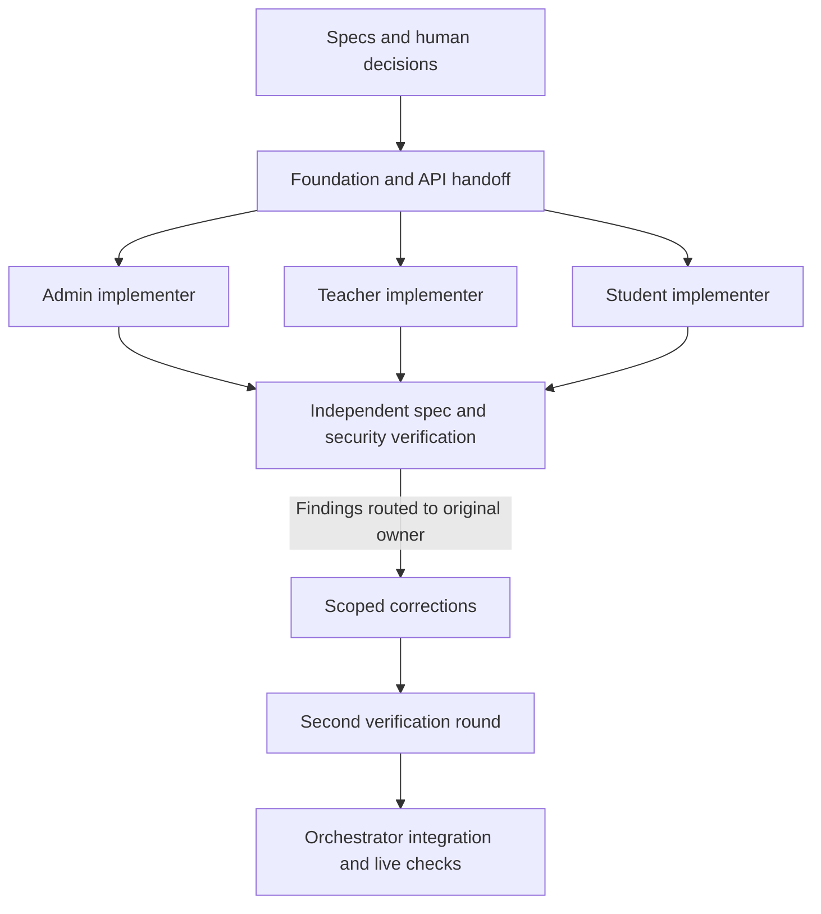

# Reflections on Multi-Agent SE, Context Engineering and Resource-aware Use

This reflection analyzes the development evidence available in the repository as of 28 October 2026. Its main sources are the [backend log](../logs/backend-implementation.md), [executor log](../logs/code-executor-implementation.md), [frontend log](../logs/frontend-implementation.md), [agent definitions](../.claude/agents/backend-role-implementer.md) and [backend handoff](../workflow/backend-implementation/HANDOFF.md). Recorded measurements are historical observations, not experiments rerun for this document. Interpretations and proposed improvements are identified separately from measured outcomes.

## 1. Coordination worked best after shared interfaces were stable

The backend used an orchestrator–subagent pattern followed by a generator–verifier loop. A foundation agent implemented shared schemas, repositories, authentication, jobs, clients, guards and fixtures first. Three role implementers then worked concurrently on admin, teacher and student modules. Finally, two independent agents checked spec conformance and security, returning findings to the original owners. The verification loop was capped at two rounds.

Disjoint file ownership was the main conflict-control mechanism. Role agents could edit only their router, feature implementation, prompt and tests. Shared schemas and repositories belonged to the foundation agent. If a role needed a shared change, it had to report the exact request instead of adding SQL or duplicate models locally. The log records no foundation requests from the three role agents. This supports the conclusion that the shared contract was sufficient for this particular decomposition; it does not establish that the same approach would work for tightly coupled features.

The phase gate also had a cost: role work waited until the foundation was built and its 71 tests passed. The recorded foundation phase took 14.3 minutes, while role implementation took 1.1, 1.9 and 2.4 minutes. The foundation was the critical path. Simply adding more role agents would not have reduced that dependency.

There is no per-agent utilization trace, so we cannot calculate idle or overloaded time. We can identify structural waiting at the foundation gate and later review gates. The bounded role scopes and zero reported foundation requests suggest little blocking during role implementation, but they do not prove that agents were continuously productive.

## 2. Independent verification caught shared misunderstandings

The first spec review found that the student hint loop could make an extra tool round. The implementer's test encoded the same misunderstanding, so self-verification passed. This is a concrete example of why a passing test written alongside a feature does not necessarily establish conformance: both can share one mistaken interpretation.

The security reviewer found that stripping imitation untrusted-content tags once could let nested tags reconstruct themselves. Repeating the stripping until stable fixed the issue, and the current guard tests cover nested tags. The process also exposed requirement gaps: co-teacher assignment editing and whether the hint title needed untrusted wrapping. These went to the human/orchestrator for a spec decision, then back to implementers.

This conflict-resolution path was useful because it separated a code defect from an ambiguous requirement. The verifier supplied a section reference and owner; the human resolved product behavior; the orchestrator updated the specification; the owner changed the implementation. A verifier's preference did not silently become a new requirement.

Verification itself needed scrutiny. In round two, the spec verifier incorrectly reported that no test covered hint-title wrapping; the orchestrator found the test. Both verifiers also missed a flaky assertion and a live startup problem. Independent review increased coverage, but did not remove the need to spot-check findings or exercise the real system.

## 3. Recorded experiments and what they establish

| Experiment or observation | Recorded result | Analysis and limit |
| --- | --- | --- |
| Shared foundation before role fan-out | 71 foundation tests; no foundation requests from role agents; integrated suite reached 124 tests | Consistent with a useful handoff and ownership split. No no-handoff control run was recorded. |
| Generator tests versus independent reviewers | First review failed; extra hint tool round and nested-tag stripping defect found | Independent review caught errors that implementation tests missed. It does not measure all missed defects. |
| Repeated tests for suspected instability | Hidden-value assertion failed about once in seven runs; after correction, eight full runs each reported 126 passes | Random nonce/canary text could accidentally contain a short hidden value such as `40`. Assertions should inspect the relevant payload rather than search an entire randomized request. |
| Mocked integration versus real startup | 126 tests and two reviews missed a doubled `/v1/v1/models` path; live startup failed | Mocks were too permissive, and an exported environment value differed from `.env`. Base URL normalization and four exact-URL tests brought the logged suite to 130. |
| Reusing reviewers for scoped rechecks | Spec review: 24 → 4 tool calls, 3.7 minutes → 50 seconds; security review: 29 → 5 calls, 3.9 minutes → 53 seconds | About 83% fewer calls in each recheck. Scope was also smaller, so this cannot isolate a benefit from context reuse or caching. |
| Live tool compatibility | Logged `coder` response invoked `get_code`; 0.9 seconds and 361 tokens | Establishes tool use for that model/key at that time. It does not validate every model or current gateway availability. |
| Executor adversarial tests | 57 tests passed in about 15 seconds on Linux | Covered resource limits, output floods, inherited secrets, child cleanup and file limits. This is not a general sandbox-escape proof. |

The live startup failure is particularly informative. An earlier gateway check read `.env` directly, while the application used settings where shell variables take precedence. Both checks seemed reasonable but tested different configurations. A better release check must start the actual application with the actual deployment environment, then exercise its endpoints. Exact HTTP URL assertions improve mocks, but only live checks cover credentials, model support and deployment routing together.

Repeated full-suite execution was justified once a flaky failure appeared. It would be wasteful as a default policy after every edit. Targeted tests should be used during implementation, one full suite after writers finish, and additional repetitions only when instability gives a reason.

## 4. Multi-agent benefits had a measurable review cost

The backend log reports these cumulative subagent token counts:

| Agent | Model label in the log | Tokens |
| --- | --- | ---: |
| Foundation | opus | 171.3k |
| Admin implementer | sonnet | 56.0k |
| Teacher implementer | sonnet | 69.2k |
| Student implementer | sonnet | 76.7k |
| Spec verifier | opus | 148.2k |
| Security verifier | opus | 132.1k |
| **Total** | | **653.5k** |

Generators account for approximately 57.1% and verifiers 42.9% of that total. Verification was a substantial part of the resource budget. Its value is supported by the concrete defects and spec gaps it found; however, the record has no equivalent single-agent implementation with matched scope, model settings and quality criteria. We therefore cannot claim a measured net speedup, monetary saving or reduction in total defects from multi-agent development.

For the initial role phase, sequential recorded durations sum to 5.4 minutes and the longest is 2.4 minutes. Ideal overlap could reduce that phase by about three minutes, excluding orchestration and contention. This is an estimate from the run record, not a measured end-to-end parallel-versus-sequential comparison. The much longer foundation phase limits its effect on total delivery time.

One coordination inefficiency was explicit: role agents ran full suites while other agents were still writing. Those results described moving snapshots and could not serve as the final integration gate. A clearer instruction would reserve the authoritative full-suite run for the orchestrator after all writers report completion. Individual agents should report targeted results and any remaining assumptions.

The failed attempt to launch a newly defined custom agent also consumed avoidable effort: the session had not loaded its definition. The workaround used a general-purpose agent that read the definition. Checking agent availability before starting a coordinated run would make the trigger mechanism more reliable.

Multi-agent work is most suitable here for independent role modules and independent review perspectives. A small UI wording change or a tightly coupled shared-core edit would usually gain little from splitting across agents. The executor and frontend logs show useful spec-driven progress without asserting parallel implementation for those components.

## 5. Context engineering reduced discovery work, but needs maintenance

The foundation handoff recorded module APIs, schema names, repository signatures, job behavior, fixtures and a usage example. Role agents were told to read the handoff and their assigned spec sections before opening implementation files. The reported handoff was 102 lines, below its 150-line limit. This gave implementers an executable contract without requiring each to reconstruct the whole backend.

Upfront context was most valuable for stable constraints: file ownership, public APIs, authorization rules, shared job semantics, test fixtures and how to report a blocked dependency. Detailed implementation internals were retrieved only when needed. The role prompts also required a structured final report with files, tests, foundation requests and spec issues, making handoffs easier to assess.

There is now a context-maintenance issue: agent definitions still refer to `backend/HANDOFF.md`, while the retained artifact is under `workflow/backend-implementation/HANDOFF.md`. Historical prompt paths are not necessarily current instructions. Before reusing the workflow, the entry points should be synchronized so agents do not waste time searching or infer that the contract is missing.

The record does not include a controlled experiment showing that extra context harmed performance. It does show a related retrieval hazard: the frontend log's first section says teacher/student pages were placeholders, but later sections and the current source implement them. Supplying only the first summary would produce an incorrect product description. Historical logs should be labeled by scope/date, while current contracts and source should determine present behavior.

A continuation note should record the current objective, accepted decisions, owned files, exact interfaces, pending findings, commands and results, relevant commit, blockers and next action. It should distinguish observations from guesses and omit secrets. Persisting these facts avoids repeated exploration without pretending to preserve private model reasoning.

## 6. Model choice and resource measurements need stronger evidence

The recorded workflow assigned opus to the foundation and verifiers, and sonnet to bounded role implementation. This was a task-based allocation: shared-core mistakes propagate to all roles, while role work has narrower contracts. The observed token counts and durations are consistent with a lighter role phase, but task complexity differs too much to attribute the difference solely to model choice. The record contains model-family labels rather than exact immutable model versions or a matched model comparison.

Returning fixes to the same agent and giving reviewers only the changed scope avoided some repeated discovery. Foundation corrections reportedly needed two calls and 37 seconds; the teacher correction needed two calls and 34 seconds. These are useful continuation observations, not measured cold-start savings for identical tasks.

Prompt-cache hit rates, cached-input tokens, cache misses and internal reasoning tokens were not recorded. Consequently, we cannot answer the brief's cache-saving or reasoning-percentage questions numerically. The 57.1%/42.9% split above measures generator/verifier work, **not** reasoning versus visible tokens. The live completion's 361-token observation is also not enough to infer that breakdown.

A useful next experiment would compare the same bounded task with a handoff versus repository exploration, and separately compare a resumed reviewer with a fresh reviewer on the same diff. Record exact model/version, input/output/cached tokens when exposed, wall time, calls, retries and independently assessed defects. Repeat tasks before drawing causal conclusions. Keep stable instructions in a consistent prefix to make caching possible, but report actual provider cache statistics before claiming savings.

By cumulative role, the foundation was the largest consumer at 171.3k tokens; together, the two verifiers consumed 280.3k. Future optimization should target repeated repository discovery and unnecessarily broad review scopes before weakening security review. The existing scoped second round is evidence that review breadth can be reduced after a complete first pass.

## 7. The application applies context and work budgets directly

Student hints start with a compact request and retrieve question/code only if the model asks. The tools expose visible tests, not hidden tests, and take no arbitrary resource IDs. This reduces upfront context and narrows access. It can still cost more calls if the model requests both sources repeatedly; without production usage telemetry, the net token saving is unmeasured.

The hint loop permits an initial completion plus three tool rounds, with a final `tool_choice=none`, and limits each completion to 1,024 output tokens. Question generation allows one JSON repair attempt and currently permits 16,384 output tokens per completion; a revision includes the parent draft, so this feature can consume substantial context. Summaries use compact aggregate data with a 512-token output cap rather than sending students' source code or identities. These values describe current code; they should not be inferred from older spec snapshots.

The common job runner deduplicates simultaneous matching actions and imposes a deadline. The SoCLaaS client bounds retries for 429/503 to two retries with backoff. The executor limits concurrent jobs, times out its queue and stops testing at the first failure. These controls bound work locally, but retry limits and deduplication do not enforce the gateway's overall request quota across different users/actions. A shared quota limiter and telemetry remain necessary to demonstrate behavior under load.

No runtime experiment in the logs measures context-size savings, model-quality tradeoffs, prompt-cache benefits or gateway quota compliance. Those should remain proposed measurements rather than retrospective claims.

## 8. Security must be enforced beyond prompt instructions

Application security combines server-side roles and membership checks, hidden-test redaction, scoped tools, input scanning, nonce-tagged untrusted text, canaries and output validation. The independent security review improved that design by finding nested-tag reconstruction. Still, a regex injection detector and a canary cover only some attacks, and the long-code filter cannot guarantee that a hint never reveals a complete solution.

The development process exposed the same distinction between instruction and enforcement. The foundation agent was told not to access `backend/.env`, yet the log records an `awk` check against it. The report says only a yes/no value was printed and no secret was disclosed. That does not make the boundary reliable: the file access itself violated the instruction. The log proposed a deny rule; the repository evidence does not establish that the rule was installed or tested.

Future runs should make secret files inaccessible through actual tool permissions, supply `.env.example` and synthetic values for ordinary work, and isolate live credential checks from implementers. Read-only verifier tool sets and explicit ownership reduce accidental mutation, but shell access can be broader than the written role description. Their real permissions need testing as well.

Similarly, the executor's resource limits and hardened container are useful controls, but all submissions share a service container and OS user. The existing tests do not prove isolation against arbitrary hostile programs. A production security claim requires stronger submission isolation and adversarial evaluation, along with authentication/AI rate controls and deployment verification.

## 9. Changes to carry into the next development cycle

1. Synchronize handoff paths and verify agent availability before launch; keep ownership, accepted spec decisions and current state concise.
2. Run targeted tests during concurrent implementation, then one authoritative integrated suite after writers finish. Repeat only when a failure or instability warrants it.
3. Keep independent security/spec review for boundary-sensitive work, route fixes to their owners, and spot-check verifier claims.
4. Add exact upstream-contract assertions and exercise real startup plus all three AI features using deployment-equivalent configuration.
5. Enforce secret/file restrictions through permissions and validate those restrictions with synthetic secrets.
6. Measure cache use, model versions, token categories, retries and task quality before claiming efficiency improvements; compare equivalent tasks rather than different agent roles.
7. Add shared SoCLaaS quota control, stronger executor isolation and a separate production deployment, then record the resulting security and load-test evidence.

The strongest supported lesson is that clear contracts and independent checks complement each other. The handoff let role agents work with few reported dependencies; verification exposed mistaken interpretations; repeated tests and a real startup check caught failures outside those reviews. The evidence supports retaining that combination while measuring its costs more carefully.
